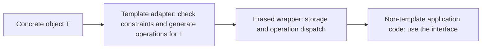
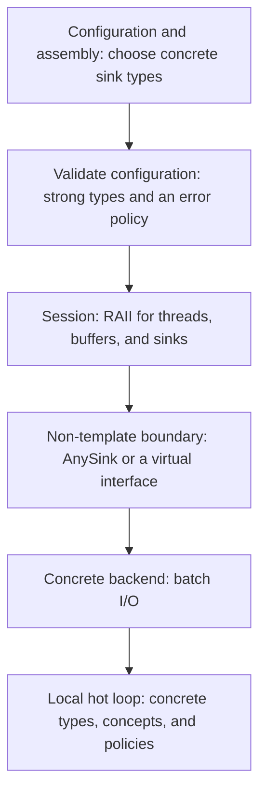

# Modern C++ Engineering: Mental Models and Design Trade-offs

[Chinese edition](modern-cpp-engineering-mental-models.md)

> The central questions: **Where does concrete information need to remain visible? Who owns each responsibility? At what stage do we pay the cost?**
>
> This guide is for developers who can read and write C++ and want a stronger framework for making engineering decisions. The examples use C++20 unless stated otherwise; C++23 and C++26 features are marked separately. The focus is on interfaces, implementations, and their trade-offs. Standards and references were checked on 2026-09-20. Working-draft links evolve; actual availability depends on your compiler, standard library, and feature-test macros.

## Reading guide

- [1. The organizing model: information, responsibility, and cost](#model)
- [2. Four approaches to the same polymorphism problem](#polymorphism)
- [3. Type erasure: expose capabilities at a boundary](#type-erasure)
- [4. Standard library examples and callback selection](#callbacks)
- [5. Ownership, value semantics, RAII, and the Rule of Zero](#ownership)
- [6. Move semantics, forwarding, and noexcept](#move)
- [7. Borrowing, views, and lifetimes](#lifetime)
- [8. Concepts, CRTP, policies, and customization points](#generic)
- [9. Strong types, state modeling, and error handling](#state)
- [10. PImpl, compilation boundaries, and ABI](#boundaries)
- [11. Data layout, SBO, PMR, and performance](#performance)
- [12. Ranges and compile-time computation](#ranges)
- [13. Concurrency, callbacks, and coroutines](#async)
- [14. Putting the pieces together](#composition)
- [15. Decision tables, misconceptions, and exercises](#review)
- [16. Further reading](#references)

For a first pass, read `1 → 2 → 3 → 5 → 7 → 14`. Use sections 4, 10, and 15 when designing an interface. For performance work, read sections 6, 11, and 12 together.

<a id="model"></a>
## 1. The organizing model: information, responsibility, and cost

A C++ object has four aspects worth reasoning about: **its representation, its operations, its lifetime, and its invariants**. An interface determines how much of that the caller can see and which obligations the caller must fulfill.

Consider a logging system. Application code may only need to write some text; it rarely needs to know whether the sink is a file, a network connection, or an in-memory buffer. It does need to know whether the call is synchronous, how long the sink may borrow the text, how failures are reported, and whether concurrent calls are allowed.

Before choosing an abstraction, answer six questions.

| Dimension | Question | Common choices |
| --- | --- | --- |
| Type information | Does the use site need the concrete type? | Concrete type, template parameter, abstract interface |
| Binding time | When is the implementation selected? | Compile time, link time, runtime |
| Ownership | Who keeps the object alive, and who destroys it? | Value, exclusive ownership, shared ownership, borrowing |
| Direction of change | Will we add implementations more often, or operations? | Open or closed set of types |
| Failure and invariants | Which states are valid? What remains after failure? | Valid on construction, explicit empty state, error values, exceptions |
| Cost and boundaries | Which costs are worth paying? | Instantiation, allocation, indirection, copying, synchronization, rebuilding |

These dimensions interact, but each needs its own decision:

- **Runtime polymorphism does not require heap allocation.** A wrapper can borrow an object on the stack or store an object in an internal buffer.
- **Type erasure does not imply shared ownership.** An erased wrapper can own, copy, share, or borrow its target.
- **Value semantics do not require inline storage.** A `std::string` can allocate its characters on the heap and still behave as a value.
- **Templates do not move all execution to compile time.** The functions they instantiate usually process data at runtime.
- **`const` does not imply thread safety.** It constrains a particular access path; other state and other access paths still matter.

A useful design rule is to **keep concrete information where it enables useful work, and hide it at boundaries where doing so reduces dependencies**. Parsing and encoding loops may benefit from concrete types. Plugin assembly, task scheduling, and public service interfaces often benefit from a small, stable contract.

<a id="polymorphism"></a>
## 2. Four approaches to the same polymorphism problem

Suppose `FileSink` and `MemorySink` are unrelated types that both support `void write(std::string_view)`. The following snippets show interface choices; concrete sink definitions are omitted.

### 2.1 Templates and concepts: retain concrete types at the use site

```cpp
// C++20; requires <concepts> and <string_view>
template<class T>
concept Sink = requires(T& sink, std::string_view text) {
    { sink.write(text) } -> std::same_as<void>;
};

template<Sink S>
void emit(S& sink, std::string_view text) {
    sink.write(text);
}
```

`emit<FileSink>` and `emit<MemorySink>` are separate instantiations. The compiler knows the call target, which creates opportunities for inlining, constant propagation, and optimization across the call. The result still depends on definition visibility and the optimizer.

The cost is that type dependencies can propagate upward. If `Logger<S>` contains an `S`, its callers may also become templates. Instantiation work, header dependencies, and generated code size can all grow.

**Mental model: each concrete type gets an algorithm specialized for it.** This works well for local hot paths, generic algorithms, and policies selected at compile time.

### 2.2 Virtual interfaces: work through an object's contract

```cpp
// C++17; requires <string_view>
struct ISink {
    virtual ~ISink() = default;
    virtual void write(std::string_view) = 0;
};

void emit(ISink& sink, std::string_view text) {
    sink.write(text);
}
```

`ISink&` borrows an existing object. `std::unique_ptr<ISink>` adds exclusive ownership. The public virtual destructor makes deletion through this base interface safe for derived objects.

A new implementation usually means a new derived class. An existing third-party type needs an adapter that implements the interface. Polymorphic objects are accessed through references or pointers; passing a derived object by value as a concrete base type can slice away its derived part. `ISink` itself is abstract, so it cannot be passed by value in the first place.

**Mental model: the caller accesses an object through the interface it promises to implement.** This is a natural fit for objects with identity, explicit lifetimes, and an established virtual interface. Compilers can sometimes devirtualize calls, so a virtual call does not have a universal, fixed performance penalty.

### 2.3 `std::variant`: enumerate a closed set of alternatives

```cpp
// C++17; requires <variant>, <string_view>, and both complete sink types
using SinkChoice = std::variant<FileSink, MemorySink>;

void emit(SinkChoice& sink, std::string_view text) {
    std::visit([&](auto& concrete) { concrete.write(text); }, sink);
}
```

The active alternative is selected at runtime, while the complete set is known at compile time. Adding an operation usually means adding a visitor. Adding a type means changing the `variant` declaration and revisiting the affected visitors.

A `variant` stores its active alternative within its own storage; it does not allocate separate storage for that purpose. An alternative may, of course, allocate internally. The wrapper's size depends on its largest alternative, alignment, and discriminator. Certain throwing operations that change alternatives can leave it `valueless_by_exception`, so an application state machine must account for the exception behavior of its alternatives. [Working draft: variant](https://eel.is/c++draft/variant.variant)

**Mental model: this is either A or B, and every use site can know the complete set.** This is useful for protocol messages, AST nodes, state machines, and a finite set of implementations. A visitor with a catch-all branch can silently accept a new alternative without handling it meaningfully; compilation alone does not establish complete application behavior.

### 2.4 Type erasure: pass a set of capabilities

```cpp
// Interface sketch; the next section defines AnySink in full
void emit(AnySink& sink, std::string_view text) {
    sink.write(text);
}
```

`AnySink` accepts concrete types that satisfy `Sink`, while callers depend only on `AnySink`. Third-party types do not need a common base class. Adaptation happens when a concrete object enters the wrapper.

**Mental model: I know which operations this object supports and what they promise, even though its concrete type is hidden.** The set of types can grow; the wrapper defines the available operations. A type-erased wrapper can use virtual functions internally, so these are not mutually exclusive implementation techniques.

### 2.5 Comparing the approaches

| Approach | What the use site knows | Adding a type | Adding an operation | Main engineering costs |
| --- | --- | --- | --- | --- |
| Templates and concepts | Concrete type and constraints | Supply a type that meets the requirements | Add a generic algorithm or requirement | Type propagation, instantiation, code size |
| Virtual interface | Base-class contract | Add a derived class or adapter | Update the interface and implementations | Interface coupling, indirection, object lifetime management |
| `variant` and visitors | Every alternative | Update the closed set and affected visitors | Add a visitor | Storage for the largest type, visitation combinations |
| Type erasure | Wrapper contract | Supply a compatible type or adapter | Update the erased interface and adapters | Wrapper implementation, indirect calls, storage policy |

These are typical extension costs, not absolute limits of the language. Visiting multiple variants can require checking the Cartesian product of their alternatives. Templates can also use explicit instantiation to keep some dependencies from propagating further.

<a id="type-erasure"></a>
## 3. Type erasure: expose capabilities at a boundary

### 3.1 What actually gets erased?

Type erasure removes **the consumer's compile-time dependency on the concrete type**. The object still has a real type, and its construction, operations, and destruction must still obey that type's rules.

Think of an erased object as:

```text
A hidden T + storage for, or a reference to, T + operations on T
                              |
                              v
                     Exposed as AnySink
```

The wrapper represents “some T that satisfies Sink.” Construction knows T; later use sites only know the contract. In type-theory terms, this resembles an existential package, `∃T. Sink(T)`. That is a conceptual analogy, not C++ syntax.

The implementation typically separates adaptation from use:



Common implementations use either a `void*` and an operation table, or an `Interface` and a `Model<T>`. The former manages function pointers explicitly; the latter uses virtual dispatch. Depending on the contract, operations may include `call`, `destroy`, `move`, or `clone`. A wrapper only needs the operations it promises.

A bare `void*` does not establish this contract. The wrapper must keep the stored T and the operations for T consistent, while correctly handling alignment, destruction, and any empty state.

### 3.2 A complete owning, move-only `AnySink`

This teaching implementation makes explicit choices: it exclusively owns its target, allows an empty state, disables copying, provides non-throwing moves, and allocates the target on the heap. `write` may modify the target. The `Sink` concept checks the signature; the additional semantic requirement is that **the sink must not retain a borrowed reference to the input text after `write` returns**.

```cpp
// C++20; save as any_sink.cpp to compile and run
#include <cassert>
#include <concepts>
#include <memory>
#include <stdexcept>
#include <string>
#include <string_view>
#include <type_traits>
#include <utility>
#include <vector>

template<class T>
concept Sink = requires(T& sink, std::string_view text) {
    { sink.write(text) } -> std::same_as<void>;
};

class AnySink {
    struct Interface {
        virtual ~Interface() = default;
        virtual void write(std::string_view) = 0;
    };

    template<Sink T>
    struct Model final : Interface {
        T value;

        template<class U>
        explicit Model(U&& x) : value(std::forward<U>(x)) {}

        void write(std::string_view text) override {
            value.write(text);
        }
    };

    std::unique_ptr<Interface> self_;

public:
    AnySink() noexcept = default;

    template<class T>
        requires (!std::same_as<std::remove_cvref_t<T>, AnySink>)
              && Sink<std::remove_cvref_t<T>>
              && std::constructible_from<std::remove_cvref_t<T>, T&&>
    explicit AnySink(T&& value)
        : self_(std::make_unique<Model<std::remove_cvref_t<T>>>(
              std::forward<T>(value))) {}

    AnySink(const AnySink&) = delete;
    AnySink& operator=(const AnySink&) = delete;
    AnySink(AnySink&&) noexcept = default;
    AnySink& operator=(AnySink&&) noexcept = default;
    ~AnySink() = default;

    explicit operator bool() const noexcept {
        return static_cast<bool>(self_);
    }

    void write(std::string_view text) {
        if (!self_) {
            throw std::logic_error("write on empty AnySink");
        }
        self_->write(text);
    }
};

struct CollectSink {
    std::shared_ptr<std::string> output;
    void write(std::string_view text) { output->append(text); }
};

struct MoveOnlySink {
    std::unique_ptr<std::string> output;
    void write(std::string_view text) { output->append(text); }
};

static_assert(std::movable<AnySink>);
static_assert(!std::copy_constructible<AnySink>);
static_assert(!std::constructible_from<AnySink, int>);
static_assert(std::is_nothrow_move_constructible_v<AnySink>);

int main() {
    auto output = std::make_shared<std::string>();
    std::vector<AnySink> sinks;
    sinks.emplace_back(CollectSink{output});
    sinks.emplace_back(MoveOnlySink{std::make_unique<std::string>()});

    for (auto& sink : sinks) {
        sink.write("hello");
    }
    assert(*output == "hello");

    AnySink moved = std::move(sinks.front());
    assert(!sinks.front());
    moved.write("!");
    assert(*output == "hello!");

    bool rejected = false;
    try {
        sinks.front().write("invalid");
    } catch (const std::logic_error&) {
        rejected = true;
    }
    assert(rejected);
}
```

```sh
clang++ -std=c++20 -Wall -Wextra -Wpedantic any_sink.cpp -o any_sink
./any_sink
```

Validation: this example was compiled and run as C++20 with Apple Clang 21, using `-Wall -Wextra -Wpedantic -Werror`, AddressSanitizer, and UndefinedBehaviorSanitizer. Additional checks covered destruction of the previous target during move assignment, target lifetime counts, the throwing-copy construction path, and rejection of non-copyable lvalues. Other examples labeled as snippets or sketches need the surrounding declarations described in the text. Examples marked incorrect illustrate invalid usage.

Five parts of the implementation carry distinct responsibilities:

1. **The constructor template is where concrete type information enters.** `remove_cvref_t` makes the stored target an object. Passing an lvalue typically copies it; passing an rvalue typically moves it. A non-copyable lvalue cannot be stored this way—the caller must explicitly transfer it.
2. **The constraints check both behavior and construction.** `Sink<T>` checks the operation; `constructible_from` checks whether the target can be built from this argument. Excluding `AnySink` prevents the forwarding constructor from interfering with the special member functions.
3. **`Model<T>` retains knowledge of T.** It forwards `write` to T, and virtual destruction destroys the correct model and its target. This implementation does not use RTTI.
4. **The non-template wrapper stops type propagation.** Higher-level code can store a `vector<AnySink>` without knowing its target types. The assembly point still needs the concrete types and template definitions.
5. **Ownership, empty-state behavior, and move semantics are deliberate choices.** The moved-from wrapper is empty because of its `unique_ptr` member. This is not a general rule for moved-from C++ objects.

Constructing a non-empty wrapper performs a dynamic allocation; the target may allocate additional storage internally. Move construction transfers a pointer. Move assignment also destroys the destination's previous target. Each `write` checks for an empty state and makes a virtual call. A production wrapper may need SBO, allocator support, copying, synchronization, or a different error policy, depending on its contract.

`AnySink` exclusively owns its `Model<T>` and the contained T. It does not automatically own everything T refers to. `CollectSink` deliberately shares a string. If T holds references or raw pointers, storing T in the wrapper does not extend the lifetimes of those referents.

### 3.3 Define what copying means before adding it

A copyable erased wrapper often adds a cloning operation to its internal interface:

```cpp
// Interface fragment: copy the target object
virtual std::unique_ptr<Interface> clone() const = 0;

// Corresponding implementation in Model<T>; T must be copyable
std::unique_ptr<Interface> clone() const override {
    return std::make_unique<Model<T>>(value);
}
```

The copy constructor calls `clone()`. Copy assignment can first construct a temporary copy, then commit with a non-throwing `swap`, leaving the destination unchanged if copying fails.

But `clone()` copies T according to T's own copy semantics. If T contains a `shared_ptr<MutableState>`, both copies still share mutable state. **Copyability alone does not establish independent value semantics.** Replacing the internal `unique_ptr` with a `shared_ptr` makes wrapper copies share the same target object, which is a different contract again.

I/O sinks often represent external identities and produce side effects, so independent copying may not be meaningful. Erased values representing shapes, expressions, or configurations are more natural candidates for cloning. Tasks, connections, and resource handles often fit a move-only design.

### 3.4 Information hidden by the interface stays hidden

If the wrapper exposes only `write`, consumers cannot directly call a concrete type's `flush_to_disk`. Frequent use of `target<T>()`, `any_cast`, or downcasts is a reason to reconsider the interface, split capabilities, or use an explicit closed set of types.

Operations involving two erased objects need particular care. How should two objects of unknown concrete types compare? Must they contain the same T? Can different types represent the same application value? Do you need type identifiers or double dispatch? These are additional contracts; the operation table for a simple `write` method does not answer them.

A small erased interface is easier to adapt. Every additional semantic guarantee increases the requirements on implementations. For more background, see the [Boost.TypeErasure introduction](https://www.boost.org/latest/doc/html/boost_typeerasure.html).

<a id="callbacks"></a>
## 4. Standard library examples and callback selection

### 4.1 What common library types hide

| Type | Hidden information | Retained operations | Ownership |
| --- | --- | --- | --- |
| `std::function<R(Args...)>` | Concrete callable type | Invocation, copy, move, destruction, and more | Owns its stored callable |
| `std::move_only_function<Signature>` | Concrete callable type | Invocation, move, destruction | Owns its stored callable |
| `std::function_ref<Signature>` | Concrete type of the referenced callable | Invocation | Borrows |
| `std::any` | Concrete stored value type | Copy, move, destruction, access by type | Owns its stored object |
| `std::shared_ptr<T>` | Deleter and other management details | Access through T and shared lifetime management | Shares ownership of the managed object |
| `std::pmr::polymorphic_allocator<T>` | Concrete memory resource type | Allocation, deallocation, resource comparison | Borrows the resource |

`std::any` can hold values of different types, but it provides no common application behavior. Stored types must be copyable, and retrieving a value generally requires its exact type. It will not convert an `int` to a `double` or give an arbitrary object a `write` operation. When a domain contract is known, compare a dedicated erased interface with `variant` first. [Working draft: any](https://eel.is/c++draft/any)

The deleter D is part of the type of `unique_ptr<T, D>`. The type `shared_ptr<T>` generally stays the same regardless of the deleter supplied at construction. What a wrapper hides and how it owns its target are separate decisions. [Working draft: unique_ptr](https://eel.is/c++draft/unique.ptr), [shared_ptr](https://eel.is/c++draft/util.smartptr.shared)

### 4.2 Choose callbacks by lifetime requirements first

| Requirement | Candidate | Standard version | What to verify |
| --- | --- | --- | --- |
| Invoke immediately; template instantiation is acceptable | `F&&` with callable constraints | C++11; concepts require C++20 | No retained borrows; acceptable instantiation cost |
| Standalone function or compatible captureless lambda | Function pointer | Predates modern C++ | Compatible signature; capturing lambdas cannot use this conversion |
| Borrow synchronously through a fixed, non-template interface | `std::function_ref` | C++26 | Target outlives every invocation; library support |
| Store a callback and allow copying | `std::function` | C++11 | Callable is copyable; captured resources have appropriate semantics |
| Store a callback that may own exclusive resources | `std::move_only_function` | C++23 | Appropriate const, reference, and noexcept qualifiers |
| Store and copy a callback with a more precise qualifier contract | `std::copyable_function` | C++26 | Library support; behavior differs from `std::function` |

The [libc++ C++23 status table](https://libcxx.llvm.org/Status/Cxx23.html) and [C++26 status table](https://libcxx.llvm.org/Status/Cxx26.html) distinguish standard versions from implementation availability. Selecting a language mode with `-std=` does not guarantee that the standard library implements every feature from that version.

Several differences matter in practice:

- Calling an empty `std::function` throws `std::bad_function_call`. [Invocation contract](https://eel.is/c++draft/func.wrap.func.inv)
- `std::move_only_function` and `std::copyable_function` require a target to be present when called. Do not expect the same empty-call exception. [Move-only invocation](https://eel.is/c++draft/func.wrap.move.inv), [copyable invocation](https://eel.is/c++draft/func.wrap.copy.inv)
- `std::function::operator()` is `const`, but can invoke a mutable lambda that changes its own state. A `const std::function` therefore does not establish read-only execution. Newer wrappers can express target invocation qualifiers more precisely. [function](https://eel.is/c++draft/func.wrap.func), [move_only_function](https://eel.is/c++draft/func.wrap.move)
- Owning a lambda does not mean owning the objects it captures by reference. Neither `std::function` nor `move_only_function` repairs a dangling `[&]` capture.
- `function_ref` is well suited to a borrowed callback used before the receiving function returns. Storing one in an object, queue, or asynchronous task requires a separate lifetime guarantee. Copying the wrapper does not copy the target. [function_ref](https://eel.is/c++draft/func.wrap.ref)

When the contract consists of one call operation, a standard callable wrapper is often sufficient. Consider a dedicated `AnySink` or `AnyTransport` when several operations must work together to maintain shared invariants.

<a id="ownership"></a>
## 5. Ownership, value semantics, RAII, and the Rule of Zero

### 5.1 Draw ownership as a graph

RAII ties resource release to the destruction of an owner. The same idea applies to memory, files, locks, mappings, and connections. On an early return or during exception unwinding, successfully constructed objects are still destroyed according to the language rules.

```text
Session ──exclusively owns──> Socket
        ──owns─────────────> RequestBuffer
        ──borrows──────────> Executor

RequestView ──borrows──> a region of RequestBuffer
```

Exclusive ownership often forms a clear tree. Shared ownership forms a graph, where cycles can prevent reference counts from reaching zero; use `weak_ptr` or redesign the relationships where appropriate. A borrowing edge does not keep its target alive. Every such edge needs a lifetime argument.

Before selecting a pointer type, write down who determines when the object dies. Reaching for `shared_ptr` because the lifetime is confusing often just moves destruction to the point where the last owner releases its reference.

### 5.2 Make parameter types express the relationship

| Parameter form | Typical meaning |
| --- | --- |
| `inspect(const T&)` | Borrow without modifying through this reference; other access paths may still modify the object |
| `update(T&)` | Borrow and permit modification |
| `find(T*)` | Borrow, potentially allowing null to represent absence; document the contract |
| `consume(std::unique_ptr<T>)` | Accept exclusive ownership |
| `retain(std::shared_ptr<T>)` | Accept a share of ownership that may be retained |
| `replace(std::unique_ptr<T>&)` | Allow replacement of the caller's owned object |
| `process(std::span<const T>)` | Borrow contiguous elements without extending their lifetime |
| `store(T)` | Accept a value; copying or moving depends on the call and implementation |

If a function only operates on T and does not participate in ownership management, `T&` or `const T&` usually expresses its needs more accurately than a smart pointer parameter. Also distinguish `const unique_ptr<T>&` from `unique_ptr<const T>`: the former restricts changes to the pointer wrapper, while the latter restricts changes to the target through that pointer.

### 5.3 Separate value, identity, and copyability

- **Value semantics** concern an observable value whose copies can ordinarily evolve independently. Examples include configurations, strings, and coordinates.
- **Identity semantics** concern a particular entity: a connection, thread, subscription, or external resource.
- **Copyability** is an available operation. A shared handle can be copied while both copies still refer to the same entity.

Storage by value, copyability, deep copying, and mathematical equality are different properties. For a type that supports copying, be able to explain whether modifying a copy can produce an observable change through the original.

### 5.4 The Rule of Zero depends on composable invariants

When members such as `vector`, `string`, and `unique_ptr` manage resources, a class usually needs no handwritten destructor, copy operations, or move operations. This is the practical benefit of the Rule of Zero. [C++ Core Guidelines: C.20](https://isocpp.github.io/CppCoreGuidelines/CppCoreGuidelines#Rc-zero)

Defaulted operations work member by member; they do not understand invariants spanning multiple members. Suppose `size_` must match the length of a buffer owned by a pointer. A defaulted move can transfer the `unique_ptr` while leaving the source's integer `size_` nonzero. If a null pointer must imply zero size, define the move operations accordingly or change the representation to eliminate the redundant state.

A user-declared destructor also affects implicit move generation. PImpl classes often need explicit move declarations with out-of-line defaulted definitions in the `.cpp` file. The Rule of Five is a prompt to review the consistency of special member functions, not an instruction to handwrite five functions for every class.

<a id="move"></a>
## 6. Move semantics, forwarding, and noexcept

### 6.1 `std::move` enables overload selection

`std::move(x)` changes the expression's value category so that it can select an rvalue overload. The selected constructor, assignment operator, or other operation determines what actually happens to the object.

```cpp
// C++11; requires <string> and <utility>
const std::string original = "payload";
std::string copy = std::move(original);  // Copies: std::move preserves const
```

A move may transfer a pointer, process elements individually, or end up calling a copy operation. Small strings, inline arrays, and container moves with incompatible allocators are reasons to examine the actual operation before assuming constant-time transfer.

Unless a more specific guarantee applies, moved-from standard library objects are left in a valid but unspecified state. They can be destroyed and used in operations whose preconditions still hold. User-defined types need their own moved-from contracts. Observing an empty moved-from `vector` does not establish a universal rule. [Working draft: moved-from states](https://eel.is/c++draft/lib.types.movedfrom)

### 6.2 Forwarding references preserve the caller's value category

```cpp
// C++20; requires <concepts>, <functional>, and <utility>
template<class F, class... Args>
    requires std::invocable<F, Args...>
decltype(auto) invoke_once(F&& f, Args&&... args) {
    return std::invoke(std::forward<F>(f),
                       std::forward<Args>(args)...);
}
```

Here, `F&&` and `Args&&...` are forwarding references because their template parameters are deduced in this context. A parameter of the fixed type `Widget&&` is an ordinary rvalue reference. An expression naming a variable is an lvalue even when that variable was declared as an rvalue reference.

`std::forward` is useful when a wrapper immediately passes an argument onward. It does not extend lifetimes, make repeated consumption of an rvalue safe, or automatically produce optimal performance. If the wrapper retains an argument, it must deliberately choose between owning a stored value and borrowing an external object.

`decltype(auto)` can preserve a returned reference. That also preserves the obligation to ensure the referent outlives its use; forwarding a reference to a local object is still invalid.

### 6.3 `noexcept` influences the algorithms around your type

Operations such as `vector` growth may copy elements when moving can throw and copying is available, in order to preserve exception guarantees. When copying is unavailable and moving can throw, some guarantees can be weaker. Using move operations alone does not establish the strong exception guarantee. [Working draft: vector modifier guarantees](https://eel.is/c++draft/vector.modifiers)

Declare `noexcept` when the implementation can uphold it. If an exception escapes a `noexcept` function, termination follows; the annotation does not make its underlying operations safe. For an erased wrapper, a non-throwing move and a non-throwing target invocation are separate promises.

When returning a named local value, normally write `return result;` to preserve the opportunity for named return value optimization (NRVO). Writing `return std::move(result);` prevents that form of NRVO. Also distinguish optional NRVO from the guaranteed copy elision introduced for certain cases in C++17.

<a id="lifetime"></a>
## 7. Borrowing, views, and lifetimes

### 7.1 Every borrow needs a validity argument

For each reference, pointer, iterator, `span`, `string_view`, or `function_ref`, answer four questions:

1. Who owns the underlying object?
2. Will that object remain alive throughout the access?
3. Can a move, replacement, or container reallocation invalidate this access?
4. Can a concurrent modification make the access unsafe?

A long lifetime does not imply a stable address: a `vector` can remain alive while reallocation invalidates pointers to its elements. An unchanged address does not establish a live object either. Object lifetime and the existence of raw storage are distinct.

```cpp
// Incorrect: local is destroyed on return; do not use the returned view
std::string_view bad_view() {
    std::string local = "temporary payload";
    return local;
}
```

Binding a `const&` directly to a temporary extends its lifetime in certain contexts. That extension cannot be passed along arbitrarily through function returns or view wrappers. Returning an owning string is often easier to reason about.

### 7.2 An owning wrapper can still contain borrowed references

```cpp
// Incorrect: std::function owns the lambda, but not local
std::function<void()> bad_callback() {
    int local = 0;
    return [&local] { ++local; };
}
```

Depending on the intended semantics, capture a value or place state that truly needs sharing under an explicit shared owner. Be precise about what gets copied: capturing a `string_view` by value copies the view, not its characters. Capturing `this` stores a pointer and does not extend the object's lifetime.

**Revisit every borrow when work crosses a return, a queue, a suspension point, or a thread boundary.** Each can invalidate the convenient assumption that the caller is still on the stack.

<a id="generic"></a>
## 8. Concepts, CRTP, policies, and customization points

### 8.1 Concepts state an algorithm's requirements at its interface

Concepts can turn a failure deep inside template instantiation into a failure to satisfy the interface's constraints. They also participate in overload selection. They express compile-time requirements; they do not create a runtime base class, vtable, or common object type for heterogeneous storage.

`Sink auto&` is still a function-template parameter. It does not denote a runtime reference capable of holding any sink. Heterogeneous storage still requires a choice such as a virtual interface, a `variant`, or an erased wrapper.

Constraints can check expression validity, signatures, and type relationships. They cannot generally prove thread safety, complexity bounds, non-retention of input, or a comparator's strict weak ordering. Standard library concepts distinguish satisfying checkable constraints from modeling the complete semantic requirements. Compilation only establishes part of the contract. [Working draft: semantic requirements](https://eel.is/c++draft/res.on.requirements)

### 8.2 CRTP gives a base class compile-time knowledge of its derived type

```cpp
// C++17; requires <string_view>
template<class Derived>
struct FlushMixin {
    void write_and_flush(std::string_view text) {
        auto& self = static_cast<Derived&>(*this);
        self.write(text);
        self.flush();
    }
};

struct FileSink : FlushMixin<FileSink> {
    void write(std::string_view);
    void flush();
};
```

The Curiously Recurring Template Pattern (CRTP) is useful for mixins and implementation reuse that depends on the derived type. Different `FlushMixin<D>` instantiations remain different types, so CRTP does not itself provide runtime selection. Supplying the wrong D or accessing derived state before it is ready during construction, or after its lifetime ends during destruction, can invalidate the assumptions behind the downcast.

If an ordinary generic free function provides the required reuse, inheritance may add little. C++23 explicit object parameters can simplify some CRTP use cases; toolchain support and readability should guide adoption.

### 8.3 Policy-based design makes behavior a compile-time parameter

For example, `Cache<Key, EvictionPolicy, LockPolicy>` selects eviction and synchronization strategies at compile time. This supports type checking, inlining, and composition. The costs include the number of policy combinations, instantiation work, and more complex public types.

This approach fits performance-sensitive library internals with a manageable set of combinations. If every configuration changes a public type and forces widespread instantiation, consider erasing some policies at a higher-level boundary.

### 8.4 ADL and customization points let algorithms and types evolve separately

Traditional generic code can write `using std::swap; swap(a, b);` to allow argument-dependent lookup (ADL) to find a customization associated with the argument types. A type does not need to inherit from a shared base class, and the algorithm does not need to enumerate all supported types.

A customization point object (CPO) exposes an operation through a function object. Many `std::ranges` entry points use this form, with constraints and candidate-selection rules defined for each customization point. A CPO has its own dispatch rules; it is more than an alias for an arbitrary ADL function.

Some libraries use `tag_invoke` as a customization convention. It is not a universal standard facility that every modern C++ library should adopt. Follow the conventions already established in the project before introducing another customization framework.

The connection to type erasure is direct: a template adapter can discover T's behavior through a customization point, then expose it through an erased runtime interface. **Non-intrusive adaptation determines which types can participate; erasure determines how much type information their consumers retain.**

<a id="state"></a>
## 9. Strong types, state modeling, and error handling

### 9.1 Put units and domain identities into the type system

```cpp
// C++11; requires <cstdint>
struct UserId { std::uint64_t value; };
struct OrderId { std::uint64_t value; };

void load_user(UserId);
// load_user(OrderId{7});  // Compile error: different ID types cannot be mixed
```

`using UserId = uint64_t` is only an alias; it does not provide this distinction. For time, start with `std::chrono` duration types. Sizes, offsets, and counts likewise deserve explicit units and a clear set of valid operations.

If a type also promises that a port is at most 65535 or a path is normalized, restrict construction or provide a validating factory. Adding a struct alone does not enforce a domain invariant.

### 9.2 Product types and sum types describe valid combinations

- `struct { A a; B b; }` expresses “A and B”: a product type.
- `variant<A, B>` expresses “either A or B”: a sum type.
- `optional<T>` expresses “a T or no value,” without an error reason.
- `expected<T, E>` expresses “a successful T or an error E,” making the failure channel visible.

A connection represented by `bool connected; bool failed; optional<Socket> socket;` admits combinations that may have no meaning. A `variant<Connecting, Connected, Failed>`, with `Connected` owning its socket, can exclude some invalid combinations from the representation itself.

Transitions still need correct implementations, including consideration of a variant's exceptional empty state. A type-state design goes further by representing different stages with different types—for example, consuming a `Builder` to produce a `Connection`. It works well for protocols with a relatively fixed call sequence. Encoding a complex runtime graph entirely in template types may be less practical.

### 9.3 Separate error propagation from resource cleanup

```cpp
// C++23 interface fragment; requires <expected> and <string_view>
enum class ParseError { empty, invalid, out_of_range };
[[nodiscard]] std::expected<int, ParseError>
parse_port(std::string_view text);
```

`expected` works well for explicit composition of recoverable failures. Exceptions can propagate failures up the call stack to an agreed handling boundary. A project may also have established status-code conventions. The choice depends on failure frequency, call structure, existing infrastructure, and error policy; different boundaries can reasonably make different choices.

Returning `expected` does not automatically catch internal exceptions or roll back side effects. RAII still handles resource cleanup. Calling `expected::value()` when it contains an error throws, so access should follow the API's state contract. [Working draft: expected](https://eel.is/c++draft/expected)

For mutating operations, specify the exception guarantee as well:

| Guarantee | What it promises on failure | Typical implementation approach |
| --- | --- | --- |
| No-throw | No exception escapes the operation | Use operations that cannot throw or handle failures internally; the promise must hold |
| Strong | The observable state remains unchanged if the operation fails | Prepare a temporary result, then commit through non-failing operations |
| Basic | Resources do not leak and invariants hold, but values may change | Permit partial progress while preserving a state that can be cleaned up or recovered |

A temporary plus `swap` can protect in-memory state. It cannot undo a packet already sent or a log entry already written. External side effects need their own transaction, idempotency, or compensation strategy.

<a id="boundaries"></a>
## 10. PImpl, compilation boundaries, and ABI

### 10.1 PImpl hides a class's representation

Type erasure hides the concrete type among a set of possible implementations. PImpl usually hides the private representation of one public class. The techniques can be combined, but they address different dependencies.

```cpp
// client.hpp; C++11, requires <memory>
class Client {
public:
    Client();
    ~Client();
    Client(Client&&) noexcept;
    Client& operator=(Client&&) noexcept;
    Client(const Client&) = delete;
    Client& operator=(const Client&) = delete;
    void poll();

private:
    struct Impl;
    std::unique_ptr<Impl> impl_;
};
```

Define `Client::Impl` in `client.cpp`, followed by functions that need the complete implementation type, including the destructor and move assignment. In particular, do not casually put `~Client() = default` in a header that only forward-declares `Impl`: `unique_ptr`'s default deleter needs the complete type when deletion is instantiated. The `noexcept` move declarations here are appropriate for the pointer member with its default deleter; additional members require another review. [C++ Core Guidelines: I.27](https://isocpp.github.io/CppCoreGuidelines/CppCoreGuidelines#Ri-pimpl)

PImpl can reduce header dependencies and limit the effect of changes to private layout. The typical costs are allocation, pointer indirection, and fewer optimization opportunities across the boundary. The API also needs to define what `poll()` does when a move has left `impl_` empty.

### 10.2 Source isolation, compilation isolation, and ABI stability are distinct

Hiding a concrete type does not make objects interchangeable across arbitrary compilers, standard libraries, and build configurations. ABI compatibility also involves name mangling, calling conventions, layout, exceptions, RTTI, allocation and deallocation, and versioning.

Plugin boundaries need particular attention:

- A shared library must stay loaded while live plugin objects still depend on its destructor code or operation tables.
- Allocation and deallocation responsibilities must be explicit, especially across different runtimes.
- Interface versions, structure sizes, and capability negotiation need an evolution policy.
- Passing exceptions or standard library objects across the boundary requires a compatible ABI contract on both sides.

For plugins built with independent toolchains, a common approach uses a platform-defined C ABI, opaque handles, versioned function tables, and paired creation and destruction functions. Compatibility still needs to be designed; `extern "C"` alone does not establish all of these guarantees.

### 10.3 Several tools can contain template dependencies

| Tool | What it controls | Remaining constraints |
| --- | --- | --- |
| Type erasure | Consumers' dependence on concrete implementation types | Adapters still instantiate; runtime interface remains fixed |
| PImpl | A public class's representation and private dependencies | Usually introduces indirection; does not itself provide polymorphism |
| Explicit instantiation / `extern template` | Where selected instantiations are generated and how much work is repeated | Does not eliminate all header parsing; useful for a controlled set of types |
| Modules, C++20 | Declaration organization and imports across translation units | Does not automatically eliminate instantiation, code growth, or ABI differences |

A useful architecture is a small template adapter around a larger non-template core. Instantiation then covers the parts that actually depend on concrete types.

<a id="performance"></a>
## 11. Data layout, SBO, PMR, and performance

### 11.1 Account for more than the indirect call

The following is a cost checklist, not a hardware equation with independent, additive terms:

```text
Total cost ≈ construction and allocation + calls and dispatch + data access
           + synchronization and ownership management + destruction
           + the effect of enabling or blocking other optimizations
```

Templates may reduce indirect calls while increasing instruction footprint. Type erasure may reduce duplicated code while limiting inlining and vectorization. A `vector<unique_ptr<Base>>` stores its pointers contiguously, but its target objects need not be contiguous.

For workloads involving many small objects, locality, allocation frequency, and the amount of work per call can matter more than dispatch itself. This connects directly to the repository's [notes on memory and caches](../memory/what-every-programmer-should-know-about-memory.md).

### 11.2 SBO trades wrapper size for fewer allocations

Small Buffer Optimization reserves storage inside a wrapper. Eligible targets are constructed in that buffer; other targets use heap storage. This changes the storage policy while preserving the erased interface seen by consumers.

A correct implementation must handle size, alignment, object lifetimes, movement, destruction, exception guarantees, and transitions between storage modes. Arbitrary non-trivial objects cannot safely be relocated with a bytewise `memcpy`.

The buffer has a cost even when unused: every wrapper becomes larger, including wrappers that hold a small function pointer. Fewer wrappers then fit in a cache line. If the wrapper promises non-throwing moves, inline storage is also constrained by the target's move behavior. The specification for `move_only_function` explicitly connects small-object optimization to nothrow move construction. [Working draft: move_only_function](https://eel.is/c++draft/func.wrap.move)

Avoid a portable rule such as “`std::function` never allocates below N bytes.” The threshold, alignment requirements, and eligibility conditions depend on the implementation. Measure with the standard library you deploy.

### 11.3 PMR makes allocation policy a runtime choice

`std::pmr::vector<T>` retains its element type T, while its allocator delegates to a `memory_resource` interface. The container type can stay the same across different resource implementations. This is runtime polymorphism applied specifically to allocation policy.

PMR is useful for request-scoped arenas, bulk release, allocation tracking, and specific memory domains. The central lifetime rule is that **the resource must remain valid for the containers and allocations that depend on it**. `monotonic_buffer_resource` does not reclaim individual blocks through `deallocate`; it releases storage in bulk through `release()` or destruction. Access to objects in that storage, and any destruction that needs it, must be finished before bulk release. [Working draft: memory resources](https://eel.is/c++draft/mem.res)

PMR does not automatically redirect every allocation made inside an element. A `pmr::vector<std::string>` does not turn ordinary strings into `pmr::string` objects. Copies, moves, and swaps across different resources are also subject to allocator rules. Check the specific operation before assuming storage can simply be transferred.

### 11.4 On hot paths, examine layout and work granularity

Suppose packet processing checks only a few fields but crosses several virtual interfaces for every packet. Compare the following designs:

1. Group work by concrete type, with contiguous storage and a concrete loop for each group.
2. Make one call through an erased interface, then process a batch inside the concrete implementation.
3. Choose an appropriate array-of-structures (AoS) or structure-of-arrays (SoA) layout for the hot fields, reducing irrelevant data loads.
4. Preallocate or reuse buffers to reduce steady-state allocation.

Batching can improve throughput while increasing queueing delay, peak memory use, or ordering constraints. Evaluate it against the service's actual requirements.

### 11.5 Measure the complete lifecycle

Separate construction, invocation, copying or moving, and destruction. Compare uniform and mixed target types, cold and warm caches, and different object sizes. Track the metrics relevant to the system: allocation count, throughput, tail latency, binary size, and build time.

When measuring erasure overhead, make each candidate perform the same work. Separate a controlled in-memory sink from real I/O so that filesystem behavior, locking, and system calls do not obscure the difference. Prevent the benchmarked work from being optimized away, and record optimization settings, LTO, compiler, and standard library versions. Results from an unoptimized build do not establish production costs.

<a id="ranges"></a>
## 12. Ranges and compile-time computation

### 12.1 Ranges compose traversal behavior

```cpp
// C++20 snippet; requires <ranges> and <vector>
std::vector<int> values{1, 2, 3, 4};
auto pipeline = values
    | std::views::filter([](int x) { return x % 2 == 0; })
    | std::views::transform([](int x) { return x * x; });
// Iteration performs the work; this pipeline borrows values
```

A view often describes a composable traversal. Lazy evaluation can avoid intermediate containers, but it also changes when computations, exceptions, and side effects occur compared with an eager algorithm. Repeated traversal may repeat transformations. Some views cache traversal state, so views should not all be treated as pure functions.

**A view can own its data.** The standard view requirements focus on move, copy, and related semantics suitable for composition; types such as `owning_view` can own an underlying range. Separately, `borrowed_range` describes iterator validity that is not tied to the lifetime of the corresponding range variable. It does not remove the requirement that the underlying elements remain alive. [Working draft: view](https://eel.is/c++draft/range.view), [borrowed_range](https://eel.is/c++draft/range.range)

Large pipelines can have complicated concrete types. Local `auto` variables usually handle this well. At a public boundary, consider whether callers need a container, a fixed interface, or an erased range, instead of exposing the entire pipeline's implementation type.

### 12.2 `constexpr`, `consteval`, and `if constexpr`

| Facility | Mental model | Typical use |
| --- | --- | --- |
| `constexpr` function | Can participate in constant evaluation when its requirements are met; can also run at runtime | Share an algorithm between compile-time and runtime use |
| `consteval` function, C++20 | Subjects calls to immediate-function constant-evaluation requirements | Validation or data generation that must happen ahead of runtime |
| `if constexpr`, C++17 | Select the retained branch during template instantiation | Choose an implementation based on type properties |
| `static_assert` | Reject an unsatisfied condition at compile time | Check layout, constants, and interface assumptions |

`constexpr` does not cause every call to be evaluated at compile time. `if constexpr` also cannot hide arbitrary invalid syntax. In particular, distinguish checks that depend on template parameters from errors that do not.

Compile-time computation moves work into the build and may increase both build time and generated data size. Judge it by where the work belongs and what it saves; template complexity is itself a maintenance cost.

<a id="async"></a>
## 13. Concurrency, callbacks, and coroutines

### 13.1 Keeping an object alive does not synchronize access to it

Separate `shared_ptr` instances can safely maintain reference counts for the same control block. That does not make concurrent reads and writes to T safe, nor does it allow unsynchronized modification of the same `shared_ptr` variable. The target still needs an appropriate locking, atomic, or immutability strategy. [Working draft: shared_ptr](https://eel.is/c++draft/util.smartptr.shared)

For an asynchronous callback, specify who owns the callback and its data, which threads may run it, whether it can be reentrant, whether execution can still occur after cancellation, and how errors reach the caller.

RAII can manage thread lifetimes too, as with C++20 `jthread`. Its stop request is cooperative: it cannot forcibly terminate a task that ignores cancellation, and waiting for that task during destruction may take a long time.

### 13.2 Coroutines preserve execution state across suspension

A useful model for a C++20 coroutine is a compiler-generated state machine, connected to a promise/awaiter protocol, with execution and lifetime policies supplied by a library. The language does not prescribe the resumption thread or automatically provide a thread pool or network event loop.

Parameter copies and local state needed across suspension points typically become part of the coroutine state. Allocation may be optimized away, but allocation-free execution is not a general guarantee. Reference parameters remain references; a coroutine frame does not give them ownership of their referents. [Working draft: coroutine definitions](https://eel.is/c++draft/dcl.fct.def.coroutine)

At each `co_await`, review the following:

- Do borrowed objects remain alive while execution is suspended? Can a coroutine using `this` outlive that object?
- May the current locks, buffers, or transactions span a suspension point?
- If execution resumes on another thread, do thread-affinity and synchronization assumptions still hold?
- Who destroys the coroutine frame? How do cancellation and unhandled exceptions reach their consumers?

For a coroutine lambda with captures, distinguish the lifetime of the closure from the lifetime of the coroutine frame. Capturing a value in the closure does not automatically keep that closure alive until coroutine completion. Passing owned values explicitly as coroutine parameters, with completion and destruction managed by the task framework, is often easier to reason about.

Like type erasure, coroutines hide implementation machinery. They also introduce a temporal boundary. Rewriting a callback as a coroutine leaves the underlying ownership questions to be resolved.

<a id="composition"></a>
## 14. Putting the pieces together

A logging pipeline with several output backends might assign responsibilities as follows:



1. Parse configuration into values with explicit units and validity constraints. Report invalid input through the chosen error channel.
2. At the assembly point, select file, network, or memory implementations, instantiate adapters, and acquire resources.
3. Let the session own its sinks. Express any sharing of an underlying connection separately.
4. Keep higher-level code dependent on `AnySink` or a virtual interface. Store background tasks in an owning callable wrapper.
5. Use `string_view` for synchronously borrowed text. For asynchronous retention, copy into an owned buffer or transfer an explicit buffer owner.
6. Batch high-frequency work where appropriate, and retain concrete type information inside each backend's hot loop.
7. If publishing a library interface, evaluate PImpl. If distributing independently built plugins, design the ABI, versioning, and unload protocol as well.

For example, changing synchronous `write(string_view)` so that it keeps using the text after returning violates the borrowing contract established earlier. A valid asynchronous design needs an appropriate interface: perhaps `std::string`, an owning buffer, or an explicit completion protocol. An unchanged function signature does not establish unchanged semantics.

A small logging system with one implementation may only need to own a concrete sink. Add abstractions in response to existing or clearly anticipated variation; each additional policy parameter creates another part of the design to maintain.

<a id="review"></a>
## 15. Decision tables, misconceptions, and exercises

### 15.1 Choose a tool based on what needs to vary

| Problem | Start by evaluating | Key question |
| --- | --- | --- |
| A hot loop must work with any type meeting a contract | Templates and concepts | Does concrete type information help optimization, and is instantiation volume manageable? |
| An object has stable identity and replaceable runtime implementations | Virtual interface with explicit ownership | Who owns it, and what does interface evolution cost? |
| Third-party types should work without inheritance, while consumers need a fixed interface | Type erasure | Is the operation set stable, and what should copying mean? |
| The implementation set is finite, and new operations are common | `variant` and visitors | How will a new alternative trigger review of all relevant operations? |
| A callback is borrowed synchronously through a non-template API | `function_ref` or an established project equivalent | Is it never retained, and does the toolchain support the wrapper? |
| A queued task captures an exclusive resource | An owning, move-only callable wrapper | Will both captured objects and anything they borrow remain valid? |
| Private dependencies cause widespread rebuilds | PImpl, smaller headers, or modules | Is the goal source isolation, build isolation, or binary compatibility? |
| Many short-lived allocations hurt request latency | PMR, an arena, or buffer reuse | Does the bulk-release boundary cover every dependent object? |
| Several booleans admit invalid combinations | Strong types, `variant`, or type-state | Does the new representation actually exclude invalid states? |
| A generic algorithm must support third-party types | Free functions, ADL, or an existing CPO | Is another customization framework necessary? |

### 15.2 Common misconceptions

| Misconception | More accurate model |
| --- | --- |
| “Type erasure is just `void*`.” | It also needs matching operations and a coherent lifetime and storage contract. |
| “Type erasure must allocate.” | Allocation follows from ownership and storage choices. |
| “Templates are always faster than virtual functions.” | Optimization opportunities, code footprint, layout, and workload determine performance. |
| “`variant` has no runtime dispatch.” | The active alternative still has to be selected; generated code depends on the implementation. |
| “A copyable wrapper has value semantics.” | Copies of its target may still share mutable state. |
| “`std::move` transfers and empties an object.” | It changes an expression's value category; the selected operation determines the behavior. |
| “Smart pointers eliminate lifetime bugs.” | Internal borrows, ownership cycles, and concurrent access still need attention. |
| “A const callable is safe to invoke concurrently.” | External state, mutable state, and writes through aliases can still conflict. |
| “Views never own anything.” | Ownership and borrowing properties depend on the specific view. |
| “Hiding a type gives me a stable ABI.” | Binary compatibility requires an additional toolchain and versioning contract. |

### 15.3 Build the model through experiments

1. **Add copying to `AnySink`.** Implement cloning and copy assignment. Compare a T that contains a string with one that contains a `shared_ptr<string>`. Modify a copy and inspect what the original can observe. Explain the distinction between copyability and value semantics.
2. **Build a borrowing `SinkRef`.** Initially accept only lvalue targets. Store a target address and a write function pointer without taking responsibility for destruction. Explain why rejecting direct temporary arguments still does not prevent a reference from dangling after a function returns; do not test this by executing a dangling access.
3. **Replace the wrapper with `variant`.** Compare the files and types affected by adding a sink with those affected by adding a `flush` operation.
4. **Change the work per call.** Compare individual writes with batched writes for the same in-memory workload. Measure construction, steady-state invocation, and allocation counts separately.
5. **Review an asynchronous lifetime.** Turn a synchronous text write into queued work. Draw the ownership and borrowing graph, decide where the data lives, then choose the callable wrapper.

Focus validation on contract boundaries: rejecting invalid types at compile time, consistent moved-from behavior, exactly-once target destruction, cleanup after failed construction, and preservation of the promised state after a failed copy. ASan and UBSan can help detect memory errors and some forms of undefined behavior; use TSan separately for concurrency issues. These tools check the situations they observe, so lifetime reasoning remains necessary. [Clang ASan](https://clang.llvm.org/docs/AddressSanitizer.html), [Clang TSan](https://clang.llvm.org/docs/ThreadSanitizer.html)

When you encounter a new technique, try to explain it in one sentence: **Which information or responsibility does it move, across which boundary, and at what cost?** That question gives each technique a place in a coherent design model.

<a id="references"></a>
## 16. Further reading

The trade-off recommendations in this guide are engineering judgments. Standard contracts and library behavior come from the corresponding specifications. Working drafts include later revisions; not every member listed on a current page was available in earlier language versions.

- [C++ Core Guidelines](https://isocpp.github.io/CppCoreGuidelines/CppCoreGuidelines): read around interfaces, resources, class invariants, and generic programming to connect language mechanisms to design decisions.
- [Boost.TypeErasure](https://www.boost.org/latest/doc/html/boost_typeerasure.html): explore composition of erased contracts and the complexity of relationships involving several hidden types. The design lessons are useful even if you do not adopt the library.
- [Sean Parent: Value Semantics and Concept Based Polymorphism](https://sean-parent.stlab.cc/presentations/2013-09-24-value-semantics/value-semantics.pdf): explore the relationship between values and runtime polymorphism.
- [C++ working draft: Polymorphic function wrappers](https://eel.is/c++draft/func.wrap): compare callback ownership, qualifiers, and empty-call contracts.
- [C++ working draft: Concepts](https://eel.is/c++draft/concepts): distinguish checkable constraints from semantic requirements.
- [libc++ C++23 implementation status](https://libcxx.llvm.org/Status/Cxx23.html) and [C++26 implementation status](https://libcxx.llvm.org/Status/Cxx26.html): separate standard membership from library availability. Consult the corresponding official status information for other standard libraries.
