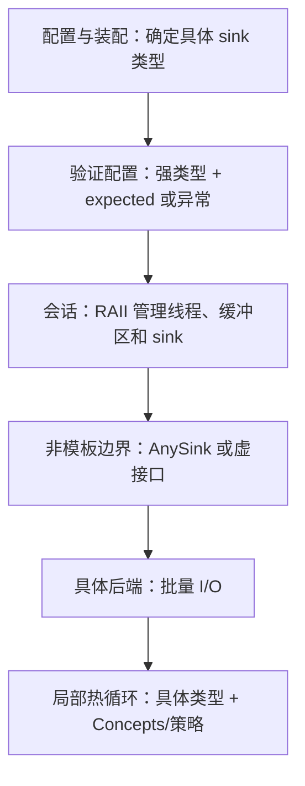

# 现代 C++ 工程实践：从 Type Erasure 建立 Mental Model

> 核心问题：**哪些信息必须保留到哪里，哪些责任由谁承担，哪些成本在哪个阶段支付？**
>
> 本文面向能读写 C++、希望理解工程设计取舍的读者。以 C++20 为主要代码基线，单独标注 C++23 / C++26 特性。重点是接口与实现的关系，而不是语法大全。标准与资料核对日期：2026-09-20；文中的工作草案链接会继续更新，具体可用性以项目的编译器、标准库和 feature-test macro 为准。

## 阅读地图

- [1. 总模型：信息、责任、成本](#model)
- [2. 用同一个问题理解四种多态](#polymorphism)
- [3. Type erasure：在边界处把类型变成能力](#type-erasure)
- [4. 标准库里的擦除与回调选择](#callbacks)
- [5. 所有权、值语义、RAII 与 Rule of Zero](#ownership)
- [6. Move、forward 与 noexcept](#move)
- [7. 借用、view 与生命周期](#lifetime)
- [8. Concepts、CRTP、策略与定制点](#generic)
- [9. 强类型、状态建模与错误处理](#state)
- [10. PImpl、编译边界与 ABI](#boundaries)
- [11. 数据布局、SBO、PMR 与性能](#performance)
- [12. Ranges 与编译期计算](#ranges)
- [13. 并发、回调与协程](#async)
- [14. 把这些实践组合成一个工程](#composition)
- [15. 决策表、误区与练习](#review)
- [16. 进一步阅读](#references)

第一次阅读可以走 `1 → 2 → 3 → 5 → 7 → 14`；需要设计接口时查第 4、10、15 节；关注性能时连着读第 6、11、12 节。

<a id="model"></a>
## 1. 总模型：信息、责任、成本

一个 C++ 对象可以从四个方面理解：**数据的表示、允许的操作、生命周期、必须成立的不变量**。一个接口则决定调用方能看见其中多少，以及调用方需要承担哪些责任。

例如，日志系统只需要“写入一段文本”，业务层通常不需要知道 sink 是文件、网络连接还是内存缓冲区。但是它必须知道：调用是否同步？文本可以借用多久？失败如何报告？多个线程能否同时调用？

设计任何抽象之前，先回答下面六个问题。

| 维度 | 要问的问题 | 常见选择 |
| --- | --- | --- |
| 类型信息 | 使用点需要知道具体类型吗？ | 具体类型 / 模板参数 / 抽象协议 |
| 绑定时间 | 实现什么时候确定？ | 编译期 / 链接期 / 运行期 |
| 所有权 | 谁让对象存活，谁负责销毁？ | 值 / 独占 / 共享 / 借用 |
| 扩展方向 | 更常增加实现，还是增加操作？ | 开放类型集合 / 封闭类型集合 |
| 失败与不变量 | 什么状态合法，失败后留下什么？ | 构造即有效 / 可空 / 错误值 / 异常 |
| 成本与边界 | 哪些成本值得支付？ | 实例化、分配、间接调用、复制、同步、重编译 |

这些维度相互影响，但不能互相替代：

- **运行期多态不意味着堆分配。** 可以借用栈上对象，也可以在固定大小存储中放对象。
- **Type erasure 不意味着共享所有权。** 擦除容器可以独占、复制、共享，也可以只借用。
- **值语义不意味着对象必须内联存储。** `std::string` 可以在堆上存字符，仍然表现为一个值。
- **模板不意味着所有事情都在编译期执行。** 模板生成的函数通常仍在运行期处理数据。
- **`const` 不意味着线程安全。** 它只限制特定访问路径上的修改，外部状态仍可能变化。

一个有用的设计准则是：**在能利用具体信息的局部保留信息，在能降低依赖的边界隐藏信息。** 例如，解析与编码的热循环保留具体类型；插件装配、任务调度和公共服务接口只暴露稳定协议。

<a id="polymorphism"></a>
## 2. 用同一个问题理解四种多态

假设有两个互不继承的类型 `FileSink`、`MemorySink`，都支持 `void write(std::string_view)`。以下是接口片段，省略具体 sink 的定义。

### 2.1 模板 + Concept：把实现知识保留到使用点

```cpp
// C++20；需要 <concepts>、<string_view>
template<class T>
concept Sink = requires(T& sink, std::string_view text) {
    { sink.write(text) } -> std::same_as<void>;
};

template<Sink S>
void emit(S& sink, std::string_view text) {
    sink.write(text);
}
```

`emit<FileSink>` 与 `emit<MemorySink>` 是不同的实例。编译器知道调用目标，容易内联、传播常量、优化调用前后的代码；能否优化仍取决于定义可见性和优化器。

代价是类型依赖向上传播：如果 `Logger<S>` 包含 `S`，那么使用 `Logger<S>` 的上层也可能继续模板化。实例化工作、头文件依赖和生成代码体积都有可能增长。

**Mental model：每一个具体类型拿到一份针对它定制的算法。** 适合局部热路径、泛型算法、编译期已知的策略。

### 2.2 虚函数接口：围绕共同的对象身份扩展

```cpp
// C++17；需要 <string_view>
struct ISink {
    virtual ~ISink() = default;
    virtual void write(std::string_view) = 0;
};

void emit(ISink& sink, std::string_view text) {
    sink.write(text);
}
```

`ISink&` 借用一个现存对象；`std::unique_ptr<ISink>` 才表达独占拥有。通过基类指针销毁派生对象时，这里的公开虚析构函数是必要的设计条件。

新增实现通常新增一个派生类；适配已有第三方类型则需要继承接口的 adapter。不要按值传 `ISink` 来表达多态；对于可实例化的基类，按值传递派生对象还可能发生 slicing。

**Mental model：调用方持有一个对象，通过对象承诺的接口工作。** 适合有明确身份、生命周期和虚函数协议的对象体系。虚调用可能被 devirtualize，不能直接等同于某个固定的性能损失。

### 2.3 `std::variant`：把所有可能性写成一个封闭集合

```cpp
// C++17；需要 <variant>、<string_view>，以及完整的两个 sink 类型
using SinkChoice = std::variant<FileSink, MemorySink>;

void emit(SinkChoice& sink, std::string_view text) {
    std::visit([&](auto& concrete) { concrete.write(text); }, sink);
}
```

运行期选择当前 alternative，编译期知道完整集合。增加一个新的操作通常新增 visitor；增加一种类型则要修改 `variant` 列表，并重新检查相关 visitor。

`variant` 在自身存储中包含当前 alternative，不为这个存储另行分配；但 alternative 自己可以分配内存。它的大小受最大 alternative、对齐和判别信息影响。某些抛异常的类型切换会导致 `valueless_by_exception`，不能笼统地把它当成永远有值的业务状态机。[标准草案：variant](https://eel.is/c++draft/variant.variant)

**Mental model：这是 A 或 B，所有使用点都能知道这个事实。** 适合协议消息、AST 节点、状态机和有限的实现集合。若 visitor 用兜底分支吞掉新类型，编译通过也不等于业务处理完整。

### 2.4 Type erasure：只传递一组能力

```cpp
// 接口草图；AnySink 的完整实现见下一节
void emit(AnySink& sink, std::string_view text) {
    sink.write(text);
}
```

`AnySink` 接受满足 `Sink` 约束的具体类型，调用方只依赖 `AnySink`。第三方类型不需要继承统一基类；适配动作发生在把类型装入包装器的时候。

**Mental model：我不知道它是什么，但我知道它能做哪些事，以及这些操作的契约。** 类型集合可以继续扩展，暴露的操作集合由包装器确定。它也可以在内部使用虚函数，因此“type erasure”和“virtual”并不是实现层面互斥的分类。

### 2.5 四种方法的对照

| 方法 | 使用点知道什么 | 添加类型 | 添加操作 | 主要工程代价 |
| --- | --- | --- | --- | --- |
| 模板 + Concept | 具体类型和约束 | 提供满足约束的新类型 | 增加泛型算法或要求 | 类型传播、实例化、代码体积 |
| 虚函数接口 | 基类协议 | 新派生类 / adapter | 修改接口及实现 | 接口耦合、间接访问、对象生命周期 |
| `variant` + visitor | 所有 alternative | 修改封闭集合及相关 visitor | 新增 visitor | 最大类型的存储成本、访问组合数 |
| Type erasure | 包装器协议 | 提供满足约束的类型 / adapter | 修改擦除协议及适配层 | 擦除层实现、间接调用、存储策略 |

这张表讨论常见设计的扩展成本，不是语言能力的绝对限制。多参数 `visit` 还可能需要为 alternative 的笛卡尔积检查调用组合；模板也可以在上层通过显式实例化限制传播。

<a id="type-erasure"></a>
## 3. Type erasure：在边界处把类型变成能力

### 3.1 擦除掉的是什么

擦除的是**使用方对具体类型的编译期依赖**，对象仍有自己的真实类型，构造、操作、销毁也仍须遵守该类型的规则。

可以把擦除后的对象理解为：

```text
某个隐藏的 T + T 的存储或引用 + 执行协议所需的操作
                            ↓
                    对外只有 AnySink
```

它类似“存在某个 T 满足 Sink”的包装：构造时知道 T，之后的使用点只知道它满足协议。用类型论术语可以类比为 `∃T. Sink(T)`，但这是帮助理解的类比，不是 C++ 语法。

从实现看，一般可以拆成两层：


常见实现是 `void* + 操作表`，或者 `Interface + Model<T>`。前者手动安排函数指针，后者借助虚函数分派。协议可能包含 `call`、`destroy`、`move`、`clone` 等操作；并不是每种包装器都需要全部操作。

单独的 `void*` 没有建立这种契约。一个可靠的包装器必须确保“存储中的 T”和“针对 T 的操作”始终匹配，并处理对齐、销毁和空状态。

### 3.2 一个完整、可编译的 owning、move-only `AnySink`

这个教学实现选择：独占拥有目标对象、允许空状态、不可复制、移动不抛异常、目标放在堆上；`write` 是可修改目标的操作。`Sink` 约束只检查签名，额外约定是 **sink 在 `write` 返回后不再借用输入文本**。

```cpp
// C++20；保存为 any_sink.cpp 可直接编译运行
#include <cassert>
#include <concepts>
#include <memory>
#include <stdexcept>
#include <string>
#include <string_view>
#include <type_traits>
#include <utility>
#include <vector>

template<class T>
concept Sink = requires(T& sink, std::string_view text) {
    { sink.write(text) } -> std::same_as<void>;
};

class AnySink {
    struct Interface {
        virtual ~Interface() = default;
        virtual void write(std::string_view) = 0;
    };

    template<Sink T>
    struct Model final : Interface {
        T value;

        template<class U>
        explicit Model(U&& x) : value(std::forward<U>(x)) {}

        void write(std::string_view text) override {
            value.write(text);
        }
    };

    std::unique_ptr<Interface> self_;

public:
    AnySink() noexcept = default;

    template<class T>
        requires (!std::same_as<std::remove_cvref_t<T>, AnySink>)
              && Sink<std::remove_cvref_t<T>>
              && std::constructible_from<std::remove_cvref_t<T>, T&&>
    explicit AnySink(T&& value)
        : self_(std::make_unique<Model<std::remove_cvref_t<T>>>(
              std::forward<T>(value))) {}

    AnySink(const AnySink&) = delete;
    AnySink& operator=(const AnySink&) = delete;
    AnySink(AnySink&&) noexcept = default;
    AnySink& operator=(AnySink&&) noexcept = default;
    ~AnySink() = default;

    explicit operator bool() const noexcept {
        return static_cast<bool>(self_);
    }

    void write(std::string_view text) {
        if (!self_) {
            throw std::logic_error("write on empty AnySink");
        }
        self_->write(text);
    }
};

struct CollectSink {
    std::shared_ptr<std::string> output;
    void write(std::string_view text) { output->append(text); }
};

struct MoveOnlySink {
    std::unique_ptr<std::string> output;
    void write(std::string_view text) { output->append(text); }
};

static_assert(std::movable<AnySink>);
static_assert(!std::copy_constructible<AnySink>);
static_assert(!std::constructible_from<AnySink, int>);
static_assert(std::is_nothrow_move_constructible_v<AnySink>);

int main() {
    auto output = std::make_shared<std::string>();
    std::vector<AnySink> sinks;
    sinks.emplace_back(CollectSink{output});
    sinks.emplace_back(MoveOnlySink{std::make_unique<std::string>()});

    for (auto& sink : sinks) {
        sink.write("hello");
    }
    assert(*output == "hello");

    AnySink moved = std::move(sinks.front());
    assert(!sinks.front());
    moved.write("!");
    assert(*output == "hello!");

    bool rejected = false;
    try {
        sinks.front().write("invalid");
    } catch (const std::logic_error&) {
        rejected = true;
    }
    assert(rejected);
}
```

```sh
clang++ -std=c++20 -Wall -Wextra -Wpedantic any_sink.cpp -o any_sink
./any_sink
```

验证记录：完整示例已在 Apple Clang 21 上按 C++20 编译运行，并通过 `-Wall -Wextra -Wpedantic -Werror`、AddressSanitizer 和 UndefinedBehaviorSanitizer 检查；额外检查了移动赋值释放旧目标、目标销毁次数、复制构造失败的清理，以及不可复制左值被约束拒绝。其余标为“片段”“草图”的代码用于解释接口，需结合相应定义使用；错误示例不能作为可运行用法。

读这段实现时，注意五个分工：

1. **构造函数模板是类型信息的入口。** `remove_cvref_t` 让包装器存一个对象；传左值通常复制对象，传右值通常移动对象。不可复制的左值不能装入，调用方必须明确转移。
2. **约束与真正的构造分别负责两件事。** `Sink<T>` 检查操作，`constructible_from` 检查目标能否从这次实参构造；排除 `AnySink` 自身避免转发构造函数干扰特殊成员函数。
3. **`Model<T>` 记住具体类型。** `write` 转发给 `T`，虚析构保证销毁正确的 `Model<T>` 与其中的 `T`。示例没有使用 RTTI。
4. **非模板 `AnySink` 截断类型传播。** 上层可以保存 `vector<AnySink>`，无需知道每个 `T`。装配点仍需要具体类型和模板定义。
5. **空状态、所有权、移动行为都是显式设计。** 这里移动后为空是由 `unique_ptr` 成员决定的，不能推广成所有 C++ 类型移动后都为空。

这个实现每次装入非空目标都会走一次动态分配，目标内部还可能继续分配。普通移动构造只转移指针；移动赋值还会销毁接收方原有目标。调用包含空状态检查和一次虚调用。它用于解释机制；生产代码是否需要 SBO、allocator、复制、线程安全或无异常接口，取决于实际契约。

`AnySink` 独占的是 `Model<T>` 及其 `T` 对象，并不自动独占 `T` 指向的全部资源。示例中的 `CollectSink` 明确共享字符串；若 T 保存引用或裸指针，包装器也不会延长那些被引用对象的生命周期。

### 3.3 如果要加入复制，必须先决定“复制的意思”

可复制擦除包装器常给内部接口添加：

```cpp
// 接口片段：复制目标对象
virtual std::unique_ptr<Interface> clone() const = 0;

// Model<T> 中的对应实现；T 必须可复制
std::unique_ptr<Interface> clone() const override {
    return std::make_unique<Model<T>>(value);
}
```

复制构造调用 `clone()`；复制赋值可以先成功构造临时副本，再用不抛异常的 `swap` 提交，从而在复制失败时保持接收方不变。

但 `clone()` 只保证按 T 的复制语义复制一个 T。如果 T 含有 `shared_ptr<MutableState>`，两个副本仍共享可变状态。**可复制不自动等于独立的值语义。** 若直接把内部 `unique_ptr` 换成 `shared_ptr`，复制就变成共享同一个目标对象，这是另一种接口承诺。

I/O sink 通常具有外部身份和副作用，强行赋予“复制后彼此独立”的语义可能没有意义。图形、表达式、配置等领域的擦除值更适合考虑 clone；任务、连接和资源句柄常适合 move-only。

### 3.4 哪些信息一旦擦除，就不能凭空取回来

只暴露 `write`，下游就不能直接调用某个具体类型专有的 `flush_to_disk`。如果业务频繁需要 `target<T>()`、`any_cast` 或向下转型，通常应重新审视协议、拆分能力，或采用显式的封闭类型集合。

两个擦除对象之间的操作尤其值得警惕：如何比较两个不知道具体类型的对象？是否只允许相同 T？不同 T 表示相同业务值时如何处理？是否需要类型标识或双重分派？这些都是新协议，单参数 `write` 的操作表不会自然解决。

这也是擦除边界应当精简的原因：操作越少，越容易适配；承诺越强，对实现的要求也越高。相关设计背景可读 [Boost.TypeErasure 的介绍](https://www.boost.org/latest/doc/html/boost_typeerasure.html)。

<a id="callbacks"></a>
## 4. 标准库里的擦除与回调选择

### 4.1 常见类型各自隐藏了什么

| 类型 | 隐藏的信息 | 保留的协议 | 所有权 |
| --- | --- | --- | --- |
| `std::function<R(Args...)>` | callable 的具体类型 | 调用、复制、移动、销毁等 | 拥有所存 callable |
| `std::move_only_function<Signature>` | callable 的具体类型 | 调用、移动、销毁 | 拥有所存 callable |
| `std::function_ref<Signature>` | 被引用 callable 的具体类型 | 调用 | 借用 |
| `std::any` | 所存值的具体类型 | 复制、移动、销毁、按类型取回 | 拥有所存对象 |
| `std::shared_ptr<T>` | 删除器等管理细节 | 通过 T 访问、共享生存期 | 共享所管理对象的所有权 |
| `std::pmr::polymorphic_allocator<T>` | memory resource 的具体类型 | 分配、释放、资源比较 | 借用 resource |

`std::any` 是“可以装不同类型的值”，并没有提供统一业务行为。存入类型需可复制，取回时通常要知道精确类型；它不会自动把 `int` 转成 `double`，也不会给任意对象增加 `write`。有明确业务协议时，应优先比较专用擦除接口与 `variant`。[标准草案：any](https://eel.is/c++draft/any)

`unique_ptr<T, D>` 的删除器 D 是类型的一部分；`shared_ptr<T>` 的类型通常不随构造时提供的删除器改变。由此可见，“隐藏什么”和“怎么拥有”是两个问题。[标准草案：unique_ptr](https://eel.is/c++draft/unique.ptr)、[shared_ptr](https://eel.is/c++draft/util.smartptr.shared)

### 4.2 回调应先按生命周期选择，再考虑分派成本

| 需求 | 候选 | 最低标准版本 | 需要确认 |
| --- | --- | --- | --- |
| 立即调用、允许模板实例化 | `F&&` + callable 约束 | C++11；Concepts 为 C++20 | 不保留借用，实例化成本可接受 |
| 无捕获或独立函数 | 函数指针 | 早于现代 C++ | 签名匹配；非捕获 lambda 才可能转为函数指针 |
| 同步借用、固定非模板接口 | `std::function_ref` | C++26 | 目标在全部调用期间存活；实现支持情况 |
| 保存回调、需要复制 | `std::function` | C++11 | 所存 callable 可复制；捕获的资源语义 |
| 保存回调、允许独占资源 | `std::move_only_function` | C++23 | 调用签名的 const / ref / noexcept 限定 |
| 保存且复制，并需更准确的限定符契约 | `std::copyable_function` | C++26 | 实现支持情况；与 `std::function` 行为并不完全相同 |

这些特性的标准版本可对照 [libc++ C++23 跟踪表](https://libcxx.llvm.org/Status/Cxx23.html)与 [C++26 跟踪表](https://libcxx.llvm.org/Status/Cxx26.html)。版本归属不保证本机可用，尤其不能只看 `-std=` 就推断标准库已经实现。

几个容易踩坑的差异：

- 空的 `std::function` 被调用会抛 `std::bad_function_call`。[调用契约](https://eel.is/c++draft/func.wrap.func.inv)
- `std::move_only_function` 和 `std::copyable_function` 要求调用前存在目标，不能期待获得同样的空调用异常。[move-only 调用契约](https://eel.is/c++draft/func.wrap.move.inv)、[copyable 调用契约](https://eel.is/c++draft/func.wrap.copy.inv)
- `std::function::operator()` 是 `const`，却可以调用一个会修改自身状态的 mutable lambda；不能由 `const std::function` 推断调用没有写操作。新包装器能更精确地表达目标调用限定符。[function 定义](https://eel.is/c++draft/func.wrap.func)、[move_only_function 定义](https://eel.is/c++draft/func.wrap.move)
- 拥有 lambda 对象不等于拥有它引用捕获的对象。`std::function`、`move_only_function` 都不能修复 `[&]` 导致的悬空。
- `function_ref` 适合只在函数返回前使用的借用回调。把它存入对象、队列或异步任务，必须额外保证目标生命周期；复制这个包装器也不会复制目标。[function_ref 定义](https://eel.is/c++draft/func.wrap.ref)

只有一个调用操作时，标准 callable 包装器往往已经足够；多个操作必须共同维护不变量时，再考虑专门的 `AnySink`、`AnyTransport` 等协议。

<a id="ownership"></a>
## 5. 所有权、值语义、RAII 与 Rule of Zero

### 5.1 所有权可以画成一张图

RAII 把资源释放绑定到拥有者的析构：内存、文件、锁、映射、连接都可以用同一思路管理。局部返回或异常展开时，已经构造成功的对象仍按规则销毁。

```text
Session ──独占──> Socket
        ──拥有──> RequestBuffer
        ──借用──> Executor

RequestView ──借用──> RequestBuffer 的某个区间
```

独占所有权常形成清晰的树；共享所有权形成图，环会阻止引用计数归零，需要 `weak_ptr` 或重新设计关系。借用边不参与保活：每条借用边都需要一个有效期证明。

选指针类型之前，先写一句话：“谁决定这个对象什么时候结束？”不要因为生命周期难以理解就默认改成 `shared_ptr`；那通常只把销毁时刻移到了最后一个引用消失的位置。

### 5.2 函数签名应该表达实际关系

| 签名片段 | 常见含义 |
| --- | --- |
| `inspect(const T&)` | 借用并只读；被引用对象仍可能被其他路径修改 |
| `update(T&)` | 借用并允许修改 |
| `find(T*)` | 借用，可用空指针表达没有对象；需约定 |
| `consume(std::unique_ptr<T>)` | 接收独占所有权 |
| `retain(std::shared_ptr<T>)` | 接收一份共享所有权，允许留存 |
| `replace(std::unique_ptr<T>&)` | 可以重置调用方的拥有者 |
| `process(std::span<const T>)` | 借用一段连续元素，不延长其生命周期 |
| `store(T)` | 接收一个值；具体复制/移动由调用及实现决定 |

如果函数只用到 T，不参与所有权管理，接收 `T&` 或 `const T&` 往往比接收智能指针更准确。还要区分 `const unique_ptr<T>&` 与 `unique_ptr<const T>`：前者限制修改指针包装器，后者限制经该指针修改目标。

### 5.3 值、身份与复制是三个不同概念

- **值语义**：关心可观察的值，复制后通常可以独立演化。例如配置、字符串、坐标。
- **身份语义**：关心“是不是同一个对象”。例如连接、线程、订阅或外部资源。
- **可复制性**：语言层面的操作能力。一个共享句柄可复制，但复制产生的仍是对同一实体的引用。

按值存储、可复制、深复制、数学意义上的相等也不是同义词。设计一个类型时，应给出“复制后修改副本，原对象能否观察到变化”的答案。

### 5.4 Rule of Zero 的前提是不变量也能正确组合

将资源交给 `vector`、`string`、`unique_ptr` 等成员管理，通常无需手写析构、复制、移动，这就是 Rule of Zero 的实用价值。[C++ Core Guidelines：C.20](https://isocpp.github.io/CppCoreGuidelines/CppCoreGuidelines#Rc-zero)

但默认成员操作只会逐成员工作，不知道跨成员不变量。例如“`size_` 必须等于指针所指缓冲区的长度”：默认移动转移 `unique_ptr` 后，源对象的整数 `size_` 可能仍非零。如果类承诺空指针必对应零长度，就需要自定义移动，或改变表示、取消冗余状态。

同样，用户声明析构函数会影响隐式移动操作的生成；PImpl 类常需要显式声明并在 `.cpp` 中默认定义移动操作。所谓 Rule of Five 是检查特殊成员的一致性，并不要求机械地手写五个函数。

<a id="move"></a>
## 6. Move、forward 与 noexcept

### 6.1 `std::move` 是转换访问方式，不是搬运指令

`std::move(x)` 将表达式转换为通常能匹配右值重载的形式。真正转移什么由被选中的构造函数、赋值运算符或其他操作决定。

```cpp
// C++11；需要 <string>、<utility>
const std::string original = "payload";
std::string copy = std::move(original);  // 通常选择复制：不能剥离 const
```

一次 move 可能只转移指针，也可能逐元素处理，甚至实际调用复制操作。小字符串、内联数组、allocator 不兼容时的容器移动，都不能简单套用“move 是 O(1)”的假设。

对标准库类型，除非有更具体的规定，移后状态通常是有效但未指定；销毁和满足前置条件的操作可以继续进行。用户类型则必须自行给出移后契约。不要从移后 `vector` 偶尔为空推导所有类型都如此。[标准草案：移后状态](https://eel.is/c++draft/lib.types.movedfrom)

### 6.2 Forwarding reference 只负责保留调用者的值类别

```cpp
// C++20；需要 <concepts>、<functional>、<utility>
template<class F, class... Args>
    requires std::invocable<F, Args...>
decltype(auto) invoke_once(F&& f, Args&&... args) {
    return std::invoke(std::forward<F>(f),
                       std::forward<Args>(args)...);
}
```

这里的 `F&&`、`Args&&...` 参与推导，才是 forwarding references；固定类型的 `Widget&&` 只是右值引用。即使变量声明为右值引用，有名字的变量表达式本身仍是左值。

`std::forward` 适合包装器立即把实参交给下一层。它不会延长生命周期，不能保证一个右值被反复转发后仍可复用，也不等于“自动得到最优性能”。若要留存实参，应明确选择拥有一个衰减后的值，还是借用外部对象。

`decltype(auto)` 可以保留返回引用，这既是能力也是责任：不能把局部对象的引用转发给调用方。

### 6.3 `noexcept` 会参与上层的算法选择

当移动可能抛异常而复制可用时，`vector` 扩容等操作可能选择复制，以维持异常保证；不可复制且移动可能抛异常时，相关保证可能更弱。不能把“用了 move”与“具有强异常保证”画等号。[标准草案：vector 修改操作的异常保证](https://eel.is/c++draft/vector.modifiers)

应当在确实能够承诺时标记 `noexcept`。异常逃出 `noexcept` 函数会触发终止，标记本身不会让底层操作变安全。擦除包装器还需要区分“移动包装器不抛异常”与“调用目标不抛异常”。

返回具名局部值时通常写 `return result;`，保留 NRVO 机会；`return std::move(result);` 会阻止这一形式的 NRVO。也要区分 C++17 的保证复制消除与可选的 NRVO。

<a id="lifetime"></a>
## 7. 借用、view 与生命周期

### 7.1 借用的有效性是一条证明义务

对每个 `T&`、指针、iterator、`span`、`string_view`、`function_ref`，都应该能回答：

1. 底层对象由谁拥有？
2. 访问期间它是否仍存活？
3. 对象是否被移动、替换，或因容器扩容而失效？
4. 并发修改是否破坏这次访问？

生命周期长并不等于地址稳定：`vector` 仍活着，但重分配可能使元素地址失效。地址没有变化也不代表对象仍活着；对象生命周期与原始存储不是同一件事。

```cpp
// 错误示例：返回时局部字符串被销毁；不要执行依赖这个结果的代码
std::string_view bad_view() {
    std::string local = "temporary payload";
    return local;
}
```

`const&` 对某些直接绑定的临时对象有生命周期延长规则，但不能通过函数返回、再包一层 view 等方式把这种延长随意传递。用拥有字符串的返回值通常更容易证明正确。

### 7.2 拥有外壳，仍然可能借用内部

```cpp
// 错误示例：std::function 拥有 lambda，却不拥有 local
std::function<void()> bad_callback() {
    int local = 0;
    return [&local] { ++local; };
}
```

常见修复方向是按值捕获，或者把真正需要共享的状态放进明确的共享所有者。但按值捕获一个 `string_view` 仍然只复制 view；捕获 `this` 也只保存对象指针，不延长对象生命周期。

**跨越返回、排队、挂起、线程切换时，重新审查所有借用。** 这些地方会改变“调用者还在栈上”的隐含假设。

<a id="generic"></a>
## 8. Concepts、CRTP、策略与定制点

### 8.1 Concepts：把算法要求写在边界

Concepts 将“模板实例化到深处才失败”前移为“接口约束不满足”，也参与重载选择。它们建立的是编译期协议，不产生运行期基类、vtable 或可用于异构容器的共同对象类型。

`Sink auto&` 仍是一个函数模板的参数，不能把它理解成“任意 sink 的运行期引用”。需要异构存储时，仍须选择虚接口、`variant` 或擦除包装器。

约束表达式可以检查签名、类型关系等事实，无法一般性证明线程安全、复杂度、输入不留存或比较器的严格弱序。标准库 concepts 区分“满足可检查约束”与“同时满足语义要求”；编译通过只覆盖其中一部分。[标准草案：语义要求](https://eel.is/c++draft/res.on.requirements)

### 8.2 CRTP：让基类在编译期知道派生类

```cpp
// C++17；需要 <string_view>
template<class Derived>
struct FlushMixin {
    void write_and_flush(std::string_view text) {
        auto& self = static_cast<Derived&>(*this);
        self.write(text);
        self.flush();
    }
};

struct FileSink : FlushMixin<FileSink> {
    void write(std::string_view);
    void flush();
};
```

CRTP 适合 mixin 和基于派生类型的实现复用。它没有让所有 `FlushMixin<D>` 变成同一种类型，也不直接解决运行期选择。错误的 D、构造析构期间访问尚未就绪的派生状态，都可能使这种向下转换不成立。

如果一个普通泛型自由函数已经能完成复用，通常不必为了“静态多态”额外引入继承。C++23 explicit object parameter 可以简化某些 CRTP 用法，但是否采用取决于工具链和可读性。

### 8.3 Policy-based design：把可变行为做成编译期参数

例如 `Cache<Key, EvictionPolicy, LockPolicy>` 允许在编译期选择淘汰和同步策略。优势是类型检查、内联和组合；代价是策略组合数、实例化成本和公共类型复杂度。

适合在库内部、性能敏感且组合数量受控的地方使用。若每个配置都改变公共类型，导致半个工程重新实例化，应考虑在上层边界擦除某些策略。

### 8.4 ADL 与 CPO：让算法和类型可以分开扩展

传统泛型代码可以使用 `using std::swap; swap(a, b);`，允许 ADL 找到与实参类型关联的定制。好处是类型不必修改统一基类，算法也不必枚举所有类型。

CPO（customization point object）把调用入口组织为函数对象；`std::ranges` 中许多入口使用这种形式，约束和候选选择规则由各定制点规定。它不是任意 ADL 函数的简单别名。

一些库使用 `tag_invoke` 作为定制协议，但它不是所有现代 C++ 库必须采用的标准通用设施。先使用项目已有约定，别为了一个定制函数自行发明复杂协议。

与 type erasure 的联系：模板适配层可以先通过定制点找到 `T` 的行为，再把它包装成运行期协议。**非侵入式适配决定“谁可以接入”，擦除决定“接入后还暴露多少类型信息”。**

<a id="state"></a>
## 9. 强类型、状态建模与错误处理

### 9.1 强类型：让单位和身份进入类型系统

```cpp
// C++11；需要 <cstdint>
struct UserId { std::uint64_t value; };
struct OrderId { std::uint64_t value; };

void load_user(UserId);
// load_user(OrderId{7});  // 编译错误，避免混用不同 ID
```

`using UserId = uint64_t` 只是别名，不能产生这种区分。时间优先考虑 `std::chrono` 的 duration；尺寸、偏移、计数等也应明确单位和允许的运算。

如果类型还要求“端口不超过 65535”“路径已经规范化”，需要限制构造入口或提供验证工厂；单独加一个 struct 并不能保证业务不变量。

### 9.2 Product type 与 sum type

- `struct { A a; B b; }` 表达“同时有 A 和 B”，即 product type。
- `variant<A, B>` 表达“处于 A 或 B 中的一种”，即 sum type。
- `optional<T>` 表达“有 T 或没有”，不提供错误原因。
- `expected<T, E>` 表达“成功 T 或错误 E”，让调用者明确看到失败通道。

如果连接状态用 `bool connected; bool failed; optional<Socket> socket;` 表示，很容易出现无意义组合。改成 `variant<Connecting, Connected, Failed>`，让 `Connected` 自己拥有 socket，可以把一部分非法组合排除在表示之外。

状态转移仍需正确实现；`variant` 也存在前述异常空状态。Type-state 则进一步用不同类型表示不同阶段，例如消费 `Builder` 得到 `Connection`。它适合调用顺序较固定的协议；复杂的运行期图不一定适合全部编码成模板类型。

### 9.3 错误传递与资源清理分开考虑

```cpp
// C++23；接口片段，需要 <expected>、<string_view>
enum class ParseError { empty, invalid, out_of_range };
[[nodiscard]] std::expected<int, ParseError>
parse_port(std::string_view text);
```

`expected` 适合显式组合可恢复失败；异常适合沿调用栈传播并在约定边界统一处理；项目也可以有状态码约定。选择取决于错误频率、调用链、已有设施与错误处理策略，不必把整个系统强行统一成一种形式。

`expected` 不会自动捕获内部异常，也不会因为返回了错误就自动回滚已经发生的副作用；RAII 仍负责资源清理。访问 `expected::value()` 的错误分支会抛异常，使用前应根据接口契约判断状态。[标准草案：expected](https://eel.is/c++draft/expected)

对修改操作，还要明确异常保证：

| 保证 | 失败后的承诺 | 常见做法 |
| --- | --- | --- |
| No-throw | 操作不向外抛异常 | 明确的无失败操作或内部处理；契约必须真实 |
| Strong | 失败后保留操作前的可观察状态 | 先准备临时结果，再通过不会失败的步骤提交 |
| Basic | 不泄漏资源，仍满足不变量，但值可能改变 | 允许部分进度，调用者能继续清理或恢复 |

“临时对象 + swap”适合内存状态，却不能撤销已经发出的网络包或写出的日志；外部副作用需要另外设计事务、幂等或补偿策略。

<a id="boundaries"></a>
## 10. PImpl、编译边界与 ABI

### 10.1 PImpl：隐藏一个类型的表示

Type erasure 隐藏“多种可能实现的具体类型”；PImpl 通常隐藏“某个公开类的私有表示”。二者可以组合，但解决的问题不同。

```cpp
// client.hpp；C++11，需要 <memory>
class Client {
public:
    Client();
    ~Client();
    Client(Client&&) noexcept;
    Client& operator=(Client&&) noexcept;
    Client(const Client&) = delete;
    Client& operator=(const Client&) = delete;
    void poll();

private:
    struct Impl;
    std::unique_ptr<Impl> impl_;
};
```

在 `client.cpp` 中定义 `Client::Impl`，然后定义析构、移动赋值等需要完整实现类型的函数。尤其不要机械地把 `~Client() = default` 放到只有前置声明的头文件里：`unique_ptr` 默认删除器执行删除时需要完整类型。这里的 `noexcept` 移动承诺针对默认删除器的指针成员；更复杂的成员仍须重新检查。[C++ Core Guidelines：I.27](https://isocpp.github.io/CppCoreGuidelines/CppCoreGuidelines#Ri-pimpl)

PImpl 可以减少头文件依赖，并让私有成员布局变化更少影响调用方；代价通常是分配、指针间接访问和更少的跨边界优化机会。移动后 `impl_` 为空时 `poll()` 怎么处理，也必须定义。

### 10.2 源码隔离、编译隔离与 ABI 稳定是不同保证

隐藏具体类型，不代表二进制可以跨任意编译器、标准库和构建选项交换对象。ABI 还涉及名称修饰、调用约定、布局、异常、RTTI、分配释放位置和版本兼容。

插件边界尤其需要考虑：

- 插件对象还活着时，包含其析构代码或函数表的动态库不能卸载。
- 谁分配，谁释放；跨不同 runtime 的释放策略需明确。
- 接口版本、结构大小和能力协商怎样演进。
- 异常和标准库对象能否穿过边界，取决于双方 ABI 契约。

面向独立工具链的插件，常见做法是平台约定下的 C ABI、opaque handle、带版本的函数表，以及配对的创建/销毁函数。它仍需设计兼容规则，并非写上 `extern "C"` 就自动解决所有 ABI 问题。

### 10.3 控制模板传播有多种工具

| 工具 | 主要控制什么 | 保留的限制 |
| --- | --- | --- |
| Type erasure | 使用方对具体实现类型的依赖 | 适配点仍实例化；固定运行期协议 |
| PImpl | 公开类的表示和私有依赖 | 通常需要间接存储；不是多态的替代品 |
| 显式实例化 / `extern template` | 某些已知实例的生成位置和重复工作 | 不会自动消除所有头文件解析；集合受控 |
| Modules（C++20） | 翻译单元间的声明组织与导入 | 不自动消除实例化、代码膨胀或 ABI 差异 |

工程上经常有效的结构是“小而具体的模板适配层 + 较大的非模板核心”。这让模板实例化只覆盖真正依赖类型的部分。

<a id="performance"></a>
## 11. 数据布局、SBO、PMR 与性能

### 11.1 不要只计算一次间接调用

下面是成本清单，不是彼此独立、可以精确相加的硬件公式：

```text
总成本 ≈ 构造与分配 + 调用与分派 + 数据访问
       + 同步与所有权维护 + 销毁
       + 被阻碍或新增的优化机会
```

模板可能减少间接调用，却增加指令体积；擦除可能降低重复代码，却妨碍内联和向量化；`vector<unique_ptr<Base>>` 中指针连续，不代表目标对象连续。

对于许多小对象，局部性、分配频率和工作粒度可能比一次分派更重要。这与仓库中的 [内存与缓存笔记](../memory/what-every-programmer-should-know-about-memory.md) 是同一个问题的另一面。

### 11.2 SBO 用对象体积换取更少的分配

Small Buffer Optimization 在包装器内部留一段缓冲区，能容纳的目标放进去，否则走堆存储。它改变的是存储策略，不改变“下游只知道协议”这一事实。

实现时至少要处理大小、对齐、对象生命周期、正确的移动/销毁、异常保证和两种存储模式的切换。不能把任意非平凡对象当字节 `memcpy` 来搬迁。

SBO 也有成本：每个包装器更大，即使多数时候存的只是小函数指针；数组遍历时每条 cache line 能容纳的对象更少。若包装器承诺不抛异常的移动，内联存储还受到目标移动行为的约束。`move_only_function` 的标准说明明确关联了小对象优化与 nothrow move。[标准草案：move_only_function](https://eel.is/c++draft/func.wrap.move)

不要写“`std::function` 小于 N 字节就绝不分配”这样的通用规则。具体阈值、对齐与准入条件属于实现细节，应在目标标准库上验证。

### 11.3 PMR 把“如何分配”变成运行期策略

`std::pmr::vector<T>` 仍保留元素类型 T，但分配器通过 `memory_resource` 协议工作。容器类型不必随每一种 resource 改变，这是在分配策略上使用运行期多态的例子。

它适合请求级 arena、批量释放、分配追踪和特定内存域。关键约束是 **resource 必须覆盖使用它的容器和分配的有效期**。`monotonic_buffer_resource` 对单次 deallocate 不逐块回收，通常在 `release()` 或销毁时整体归还存储；整体释放前，依赖其中对象的访问和析构必须妥善结束。[标准草案：memory resources](https://eel.is/c++draft/mem.res)

PMR 不自动让元素内部的所有分配都走同一个资源。例如 `pmr::vector<std::string>` 不会把普通 `std::string` 变成 `pmr::string`。跨不同 resource 的复制、移动和交换还受 allocator 规则影响，应按具体操作核查，不能假设一直能“偷指针”。

### 11.4 热路径优先调整数据与工作粒度

假设每个包只做几个字段判断，却经过多层逐包虚调用。可比较这些设计：

1. 按具体类型分组，每组使用连续存储与具体循环。
2. 在外层调用一次擦除接口，内部批量处理一组包。
3. 对热点字段采用合适的 AoS / SoA 布局，减少无用数据加载。
4. 预先分配或复用缓冲区，减少稳态中的分配。

批量处理可能改善吞吐，却增加等待延迟、峰值内存或排序约束。应按服务目标评估，而不是把“批处理更快”当成无条件结论。

### 11.5 测量要覆盖完整生命周期

至少区分构造、调用、复制/移动、销毁；分别观察单一目标与混合目标、冷缓存与热缓存、不同对象尺寸。同时记录分配次数、吞吐、尾延迟、binary size 和编译时间中真正相关的指标。

测擦除开销时，先让几种方案完成相同工作，并把可控的内存 sink 与真实 I/O 分开；否则文件系统、锁和系统调用可能掩盖差异。避免调用被完全优化掉，检查优化级别、LTO、编译器和标准库版本。不要把无优化构建中的结果推广到生产。

<a id="ranges"></a>
## 12. Ranges 与编译期计算

### 12.1 Ranges：把遍历过程组合起来

```cpp
// C++20；片段，需要 <ranges>、<vector>
std::vector<int> values{1, 2, 3, 4};
auto pipeline = values
    | std::views::filter([](int x) { return x % 2 == 0; })
    | std::views::transform([](int x) { return x * x; });
// 迭代 pipeline 时执行相应计算；pipeline 此处借用 values
```

View 通常描述一个可组合的遍历过程；这种惰性可以避免中间容器，也意味着计算、异常和副作用发生的时间与 eager 算法不同。重复遍历可能重新执行转换；有些 view 会缓存一部分遍历状态，不能把它们一概当作纯函数。

**`view` 不等于“不拥有数据”。** 标准的 view 要求主要围绕适于组合的移动、复制等语义，`owning_view` 等可以拥有底层范围。`borrowed_range` 则表示迭代器的有效期可以不受相应 range 变量生命周期限制，它没有取消对底层元素存活的要求。[标准草案：view](https://eel.is/c++draft/range.view)、[borrowed_range](https://eel.is/c++draft/range.range)

大型 pipeline 的具体类型可能很复杂。局部使用 `auto` 通常方便；公共边界则根据用途选择容器、固定协议或擦除后的 range，避免把整个实现形状传播到调用者。

### 12.2 `constexpr`、`consteval`、`if constexpr`

| 工具 | Mental model | 常见用途 |
| --- | --- | --- |
| `constexpr` 函数 | 允许在满足条件的上下文进行常量求值，也可运行期调用 | 共用运行期与编译期算法 |
| `consteval` 函数（C++20） | 对调用施加立即函数的常量求值要求 | 必须提前验证、生成的数据 |
| `if constexpr`（C++17） | 模板实例化时按条件选择保留的分支 | 根据类型性质选择实现 |
| `static_assert` | 在编译期拒绝不满足的条件 | 布局、常量、协议约束 |

`constexpr` 不会让所有调用自动在编译期执行；`if constexpr` 也不是随意隐藏非法语法的工具，尤其要区分依赖模板参数的检查与非依赖错误。

编译期计算把一部分运行期工作搬到构建阶段，还可能增加构建时间和生成数据体积。依然用“把成本放在哪个阶段最合理”评估，不把模板技巧的复杂程度当成设计质量。

<a id="async"></a>
## 13. 并发、回调与协程

### 13.1 保活不等于同步

不同 `shared_ptr` 实例可以安全地维护同一个控制块的引用计数，但这不意味着目标 T 可以并发读写，也不意味着可以无同步地同时修改同一个 `shared_ptr` 变量。目标数据的锁、原子或不可变策略仍需单独设计。[标准草案：shared_ptr](https://eel.is/c++draft/util.smartptr.shared)

设计异步回调时至少要明确：谁拥有回调，谁拥有它访问的数据，允许在哪些线程执行，是否可能重入，取消后是否还可能执行，以及错误如何交回调用方。

RAII 也能管理线程生命周期，例如 C++20 `jthread`；但它的停止请求是协作式的，不能强制终止一个不响应停止的任务，析构时等待结束也可能很久。

### 13.2 协程：把执行状态跨挂起点保存下来

可以把 C++20 协程理解为“编译器生成的可挂起状态机 + promise/awaiter 协议 + 由运行库管理的执行与生命周期”。协程本身不规定它必须在哪个线程恢复，也不自动提供线程池或网络事件循环。

参数副本、跨挂起点需要保留的局部状态等通常进入协程状态；其分配可能被优化，但不能假设没有分配。引用参数仍是引用，不会因为有协程帧就拥有被引用对象。[标准草案：协程定义](https://eel.is/c++draft/dcl.fct.def.coroutine)

对每个 `co_await`，检查：

- 挂起期间，借用的对象是否仍然存在？持有 `this` 的协程是否比对象活得更久？
- 持有的锁、缓冲区或事务是否允许跨挂起点？
- 恢复线程改变后，线程亲和性和同步条件是否仍成立？
- 谁销毁协程帧，取消怎样传播，未处理异常怎样到达使用方？

捕获 lambda 的协程还要区分 closure 生命周期和 coroutine frame 生命周期：把值捕获进 closure，并不自动保证 closure 能活到协程完成。更易推理的方式通常是把需要拥有的值作为协程参数显式传入，并由任务框架管理完成与销毁。

这与 type erasure 的共同点是隐藏实现；额外难点是同时跨越了时间边界。把回调换成协程语法，不会自动解决所有权问题。

<a id="composition"></a>
## 14. 把这些实践组合成一个工程

以支持多个输出后端的日志管线为例，可以这样分工：



1. 配置解析产出有单位、有有效性约束的值；输入失败沿约定错误通道返回。
2. 装配点选择文件、网络或内存实现，在这里实例化 adapter 并创建资源。
3. 会话拥有 sink，生命周期随会话结束；是否共享某个底层连接单独表达。
4. 上层稳定依赖 `AnySink` 或虚接口，后台任务通过拥有型 callable 包装器保存。
5. 同步传入的文本可以是 `string_view`；要异步留存，就复制到拥有的缓冲区，或转移明确的 buffer owner。
6. 高频执行部分尽可能批量化，在具体后端保留静态类型信息。
7. 若要公开库接口，再评估 PImpl；若要独立发布插件，再设计 ABI、版本和卸载协议。

例如把同步接口 `write(string_view)` 改为“返回后继续使用文本”的异步实现，会违反前面的借用契约。正确演进需要调整协议，可能是接收 `std::string`、拥有型 buffer，或明确的异步完成协议。相同函数签名不代表相同语义。

当日志系统很小、实现只有一种时，直接拥有具体 sink 就足够。抽象应回应已经出现或明确可预期的变化，而不是先把所有维度都做成模板参数。

<a id="review"></a>
## 15. 决策表、误区与练习

### 15.1 从变化方式选工具

| 我遇到的问题 | 优先评估 | 关键追问 |
| --- | --- | --- |
| 热循环需要调用任意符合协议的实现 | 模板 + Concepts | 具体类型是否有助于优化，实例化量是否受控？ |
| 对象有稳定身份、运行期可替换实现 | 虚接口 + 明确的 owner | 谁拥有对象，接口演进成本是多少？ |
| 第三方类型无需继承，且下游接口要固定 | Type erasure | 操作集合是否稳定，复制语义是什么？ |
| 实现集合有限，经常添加不同操作 | `variant` + visitor | 新 alternative 如何触发完整检查？ |
| 同步借用回调，但不想把实现做成模板 | `function_ref` 或项目同类设施 | 是否绝对不留存，工具链是否支持？ |
| 任务要捕获独占资源并排队 | move-only owning callable | 捕获对象与其内部借用都能存活吗？ |
| 私有依赖导致大面积重编译 | PImpl、缩小头文件、modules 等 | 需要源码隔离还是二进制兼容？ |
| 大量短命分配影响请求延迟 | PMR / arena / 复用 | 整体释放边界能否覆盖所有对象？ |
| 多个 bool 组合出非法状态 | 强类型、`variant`、type-state | 是否把非法状态真正排除了？ |
| 泛型算法需要接入第三方类型 | 自由函数、ADL / 已有 CPO | 有没有必要新增定制框架？ |

### 15.2 常见误区

| 容易形成的印象 | 更准确的判断 |
| --- | --- |
| “Type erasure 就是 `void*`” | 它还必须有匹配的操作、生命周期和存储契约 |
| “擦除必然分配内存” | 分配取决于拥有方式与存储策略 |
| “模板一定比虚函数快” | 优化机会、代码体积、布局和真实负载共同决定 |
| “`variant` 没有运行期分派” | 活跃 alternative 仍需选择；生成形式取决于实现 |
| “可复制包装器就是值语义” | 目标复制可能仍共享可变状态 |
| “`std::move` 会移动并清空对象” | 它是转换；真正行为由目标操作决定 |
| “智能指针让生命周期问题消失” | 内部借用、所有权环、并发访问仍需处理 |
| “有 `const` 就能并发调用” | 外部状态、mutable 状态和别名写入仍可能冲突 |
| “view 总是无所有权” | 具体 view 的拥有方式与借用性质要分别检查 |
| “隐藏类型就稳定了 ABI” | 二进制兼容需要额外的工具链与版本契约 |

### 15.3 用实验巩固模型

1. **给 `AnySink` 加复制。** 实现 clone 与复制赋值。一个 T 保存字符串，另一个 T 保存 `shared_ptr<string>`；比较修改副本后的观察结果，解释可复制与值语义的区别。
2. **做一个借用版本 `SinkRef`。** 先只接受左值目标，使用目标地址和写入函数指针，不负责删除。解释为何这能拒绝直接传临时对象，却仍不能防止函数返回后悬空；不要通过执行悬空访问验证。
3. **替换为 `variant`。** 比较新增一个 sink 与新增一个 `flush` 操作分别影响哪些文件和类型。
4. **改变调用粒度。** 对同一纯内存工作负载比较逐条写入和批量写入，分别记录创建成本、稳态调用和分配次数。
5. **检查异步生命周期。** 把一次同步文本写入改为排队执行，画出 owner / borrow 图，先确定数据归属，再选 callable 包装器。

验证时优先测试契约边界：无效类型能否在编译期拒绝，移动后行为是否一致，目标恰好销毁一次，构造失败是否泄漏，复制失败后是否保持约定状态。ASan/UBSan 可辅助检查内存和部分未定义行为；并发问题可另用 TSan。工具只能覆盖实际检查到的情况，不能代替生命周期证明。[Clang ASan](https://clang.llvm.org/docs/AddressSanitizer.html)、[Clang TSan](https://clang.llvm.org/docs/ThreadSanitizer.html)

遇到一个新技巧时，尝试用一句话描述它：**“它把哪一种信息或责任，从哪里移动到了哪里，代价是什么？”** 能回答这个问题，就能把新技巧放进已有模型，而不是再记一个孤立术语。

<a id="references"></a>
## 16. 进一步阅读

正文中的取舍建议是工程判断；标准契约与库行为以相应规范为依据。工作草案包含后续修订，不应把页面上所有成员函数都视为旧标准版本已提供。

- [C++ Core Guidelines](https://isocpp.github.io/CppCoreGuidelines/CppCoreGuidelines)：围绕接口、资源、类不变量和泛型设计阅读，比按语法章节背诵更容易串起来。
- [Boost.TypeErasure](https://www.boost.org/latest/doc/html/boost_typeerasure.html)：理解擦除协议如何组合，以及多类型关系带来的复杂性；不意味着项目必须引入该库。
- [Sean Parent：Value Semantics and Concept Based Polymorphism](https://sean-parent.stlab.cc/presentations/2013-09-24-value-semantics/value-semantics.pdf)：从值与运行期多态的关系继续深入。
- [C++ 工作草案：Polymorphic function wrappers](https://eel.is/c++draft/func.wrap)：对照各类 callback wrapper 的所有权、限定符和空调用契约。
- [C++ 工作草案：Concepts](https://eel.is/c++draft/concepts)：区分可检查约束与语义要求。
- [libc++ C++23 实现状态](https://libcxx.llvm.org/Status/Cxx23.html)、[C++26 实现状态](https://libcxx.llvm.org/Status/Cxx26.html)：区分标准版本与库实现支持；其他标准库也应查其官方状态表。
